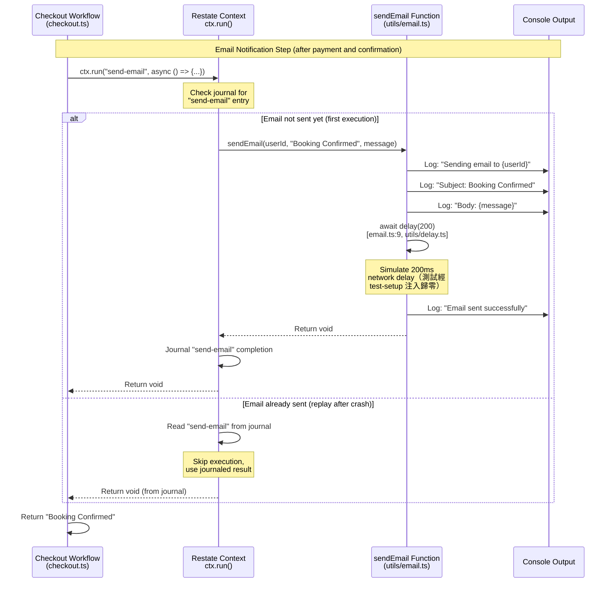
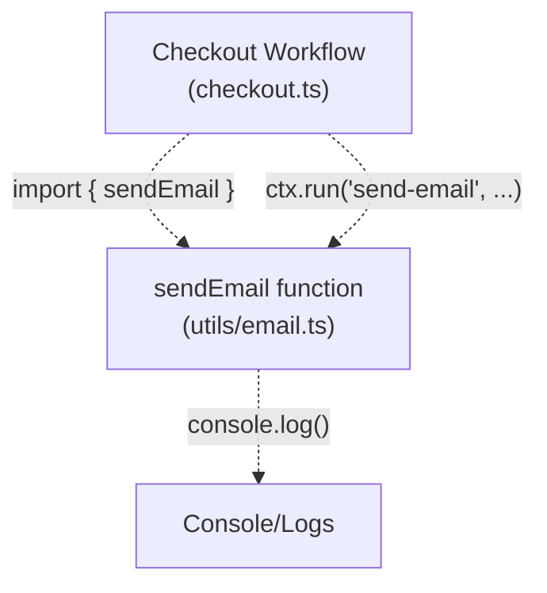

# Email Service

> **Relevant source files**
> * [src/checkout.ts](https://github.com/philipz/restate-cloudflare-workers-poc/blob/513fd0f5/src/checkout.ts)
> * [src/utils/email.ts](https://github.com/philipz/restate-cloudflare-workers-poc/blob/513fd0f5/src/utils/email.ts)
> * [src/utils/delay.ts](../../src/utils/delay.ts)
> * [test/email.test.ts](../../test/email.test.ts)
> * [test/delay.test.ts](../../test/delay.test.ts)

## Purpose and Scope

This document describes the email notification utility used in the nexus-poc system for sending booking confirmation messages. The email service is a simulated implementation that logs email details to the console rather than sending actual emails. It is invoked by the Checkout workflow as part of the final step after successful payment and ticket confirmation.

For information about the Checkout workflow that uses this service, see [Checkout Workflow](/philipz/restate-cloudflare-workers-poc/2.3-checkout-workflow). For the payment simulation utility, see [Payment Simulation](/philipz/restate-cloudflare-workers-poc/4.1-payment-simulation).

**Sources:** [src/utils/email.ts L1-L11](https://github.com/philipz/restate-cloudflare-workers-poc/blob/513fd0f5/src/utils/email.ts#L1-L11)

 [src/checkout.ts L42-L45](https://github.com/philipz/restate-cloudflare-workers-poc/blob/513fd0f5/src/checkout.ts#L42-L45)

---

## Function Signature

The email service exports a single asynchronous function:

```
sendEmail(to: string, subject: string, body: string): Promise<void>
```

| Parameter | Type | Description |
| --- | --- | --- |
| `to` | `string` | Recipient identifier (typically a `userId`) |
| `subject` | `string` | Email subject line |
| `body` | `string` | Email message content |
| **Returns** | `Promise<void>` | Resolves after simulated send operation completes |

**Sources:** [src/utils/email.ts L1](https://github.com/philipz/restate-cloudflare-workers-poc/blob/513fd0f5/src/utils/email.ts#L1-L1)

---

## Implementation Details

### Simulation Behavior

The `sendEmail` function simulates email delivery through the following steps:

1. **Log recipient and content** - Outputs the `to`, `subject`, and `body` parameters to the console [src/utils/email.ts:4-6](../../src/utils/email.ts)
2. **Simulate network latency** - Awaits `delay(200)` — the injectable delay abstraction from `src/utils/delay.ts` — to mimic real email gateway latency [src/utils/email.ts:9](../../src/utils/email.ts)。現況**不再內嵌 `setTimeout`**；正式環境的預設實作等價於 200ms 的 `setTimeout`，行為不變
3. **Log success confirmation** - Outputs "Email sent successfully" message [src/utils/email.ts:11](../../src/utils/email.ts)

The function always succeeds and never throws errors, making it suitable for fire-and-forget notification scenarios（此「永不失敗」的契約由 `test/email.test.ts` 鎖住）。

**Sources:** [src/utils/email.ts L1-L11](https://github.com/philipz/restate-cloudflare-workers-poc/blob/513fd0f5/src/utils/email.ts#L1-L11)

---

## Integration with Durable Execution

### Usage in Checkout Workflow

The email service is invoked within the Checkout workflow as the **final step (Step 5)**, positioned right after ticket confirmation（`ticket.confirm` 與 SeatMap `SOLD` 回寫，checkout.ts:48–51）. It is wrapped in a `ctx.run("send-email", ...)` call (checkout.ts:53–56) so its journaled result is not re-executed on replay——注意這是 **at-least-once** 而非 exactly-once 語意：

```javascript
// Step 5: Send Email
await ctx.run("send-email", async () => {
    await sendEmail(userId, "Booking Confirmed", `You have successfully purchased ticket ${ticketId}.`);
});
```

The `ctx.run()` wrapper provides the following guarantees:

* **Idempotency (at-least-once)** - If the workflow is replayed after a crash and the "send-email" result is already journaled, the step is not re-executed; a crash **before** journaling replays the closure and the email may be sent again. 對確認信這種重複即可接受的通知，此語意是刻意取捨（付款步驟的同源風險見 [Payment Simulation — 錯誤分類與重試語意](./Payment-Simulation.md#錯誤分類與重試語意現況)）
* **Ordering** - The email is only sent after the ticket state has been successfully set to `SOLD`
* **Durability** - The email send operation is recorded in Restate's journal
* **Retry on failure** - Unlike the payment step (whose errors are wrapped in `TerminalError` and never retried), `send-email` 沒有 `TerminalError` 包裝：目前 `sendEmail` 永不擲錯所以實際上不會發生，但若未來換成真實郵件服務並讓暫時性失敗外拋，該 invocation 會依本 repo **未設定**因而沿用 Restate server 預設重試政策的 retry policy 重試（預設值與出處見 [Payment Simulation](./Payment-Simulation.md#錯誤分類與重試語意現況)）

**Sources:** [src/checkout.ts:48-56](../../src/checkout.ts)

### Message Content Structure

The Checkout workflow constructs email messages with the following pattern:

| Field | Value |
| --- | --- |
| **Recipient** | `userId` (from checkout request) |
| **Subject** | `"Booking Confirmed"` |
| **Body** | `"You have successfully purchased ticket {ticketId}."` |

Example invocation for `userId: "user-123"` and `ticketId: "seat-5"`:

```yaml
To: user-123
Subject: Booking Confirmed
Body: You have successfully purchased ticket seat-5.
```

**Sources:** [src/checkout.ts L44](https://github.com/philipz/restate-cloudflare-workers-poc/blob/513fd0f5/src/checkout.ts#L44-L44)

---

## Email Service Flow Diagram



**Sources:** [src/checkout.ts L42-L45](https://github.com/philipz/restate-cloudflare-workers-poc/blob/513fd0f5/src/checkout.ts#L42-L45)

 [src/utils/email.ts L1-L11](https://github.com/philipz/restate-cloudflare-workers-poc/blob/513fd0f5/src/utils/email.ts#L1-L11)

---

## Execution Context and Error Handling

### Fire-and-Forget Semantics

Although the email send operation is awaited in the workflow code, it is effectively a fire-and-forget operation because:

1. **No error handling** - The `sendEmail` function never throws errors, so workflow execution always continues
2. **Post-confirmation** - The email is sent after the ticket has already been marked as `SOLD`, so email failure does not affect booking validity
3. **Non-critical notification** - The email serves as a confirmation convenience, not a required transactional step

This design prioritizes workflow completion over notification delivery.

**Sources:** [src/utils/email.ts L1-L11](https://github.com/philipz/restate-cloudflare-workers-poc/blob/513fd0f5/src/utils/email.ts#L1-L11)

 [src/checkout.ts L42-L48](https://github.com/philipz/restate-cloudflare-workers-poc/blob/513fd0f5/src/checkout.ts#L42-L48)

### Simulated Network Delay

The 200ms delay in the email function serves two purposes:

1. **Realistic testing** - Simulates real-world email gateway latency for load testing scenarios
2. **Observability** - Makes the email step visible in timing analysis and logs, confirming it executed

For comparison, the payment simulation uses 500ms delay [src/utils/payment_new.ts], making email approximately 2.5x faster than payment processing.

The wait now goes through the injectable `delay()` abstraction ([src/utils/delay.ts](../../src/utils/delay.ts)) rather than an inlined `setTimeout`: production behavior is unchanged (default implementation is the real timer), while unit tests zero it out globally—`test/loader/test-setup.mjs` 於測試啟動時注入 `setDelayImpl(() => Promise.resolve())`，所以 `sendEmail` 在測試中不再真的等 200ms。延遲長度本身從未被測試斷言；注入機制的契約測試見 [test/delay.test.ts](../../test/delay.test.ts)。

**Sources:** [src/utils/email.ts:9](../../src/utils/email.ts)

 [src/utils/delay.ts](../../src/utils/delay.ts)

---

## Module Structure and Dependencies

### Import Path

The email service is imported by the Checkout workflow using a relative path:

```javascript
import { sendEmail } from "./utils/email";
```

This places the email utility in the `src/utils/` directory alongside other supporting services like payment simulation.

**Sources:** [src/checkout.ts L4](https://github.com/philipz/restate-cloudflare-workers-poc/blob/513fd0f5/src/checkout.ts#L4-L4)

### Dependency Graph



**Sources:** [src/checkout.ts L4](https://github.com/philipz/restate-cloudflare-workers-poc/blob/513fd0f5/src/checkout.ts#L4-L4)

 [src/utils/email.ts L1-L11](https://github.com/philipz/restate-cloudflare-workers-poc/blob/513fd0f5/src/utils/email.ts#L1-L11)

---

## Console Output Format

### Example Log Output

When `sendEmail("user-123", "Booking Confirmed", "You have successfully purchased ticket seat-5.")` is invoked, the console output is:

```yaml
Sending email to user-123
Subject: Booking Confirmed
Body: You have successfully purchased ticket seat-5.
Email sent successfully
```

This four-line format provides clear visibility into email operations during testing and debugging.

**Sources:** [src/utils/email.ts L2-L9](https://github.com/philipz/restate-cloudflare-workers-poc/blob/513fd0f5/src/utils/email.ts#L2-L9)

---

## Future Considerations

### Production Email Gateway Integration

To replace the simulated email service with a real email provider, the following changes would be required:

1. **Add email provider SDK** - Install a library like SendGrid, Mailgun, or AWS SES SDK
2. **Update `sendEmail` implementation** - Replace console logs with actual API calls
3. **Add error handling** - Wrap email sending in try-catch to handle API failures gracefully
4. **Preserve `ctx.run` wrapper** - Keep the durable execution wrapper so a journaled delivery is not repeated on replay（at-least-once：journal 前崩潰仍可能重發；若真實 API 會因暫時性失敗擲錯，未包 `TerminalError` 的失敗將依重試政策重試，見上文）
5. **Configure credentials** - Add email provider API keys to Cloudflare Workers secrets

The current function signature (`to`, `subject`, `body`) is compatible with most email providers, minimizing refactoring.

**Sources:** [src/utils/email.ts L1-L11](https://github.com/philipz/restate-cloudflare-workers-poc/blob/513fd0f5/src/utils/email.ts#L1-L11)