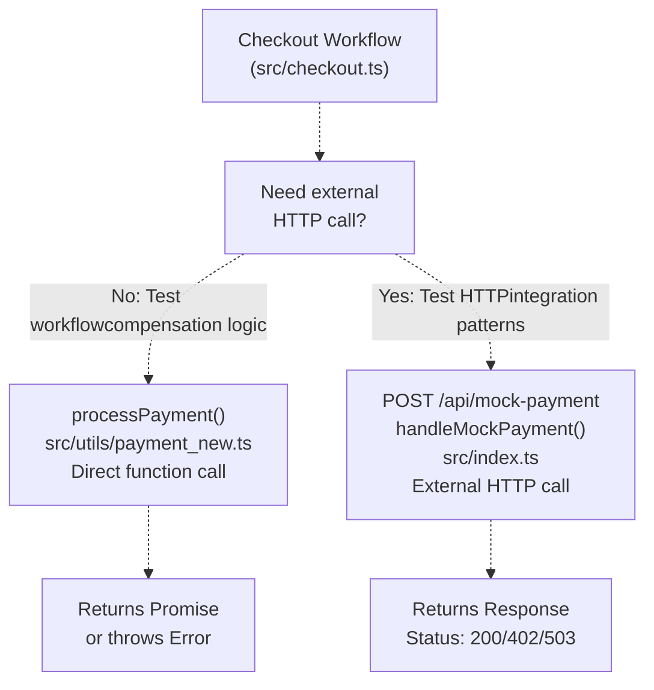
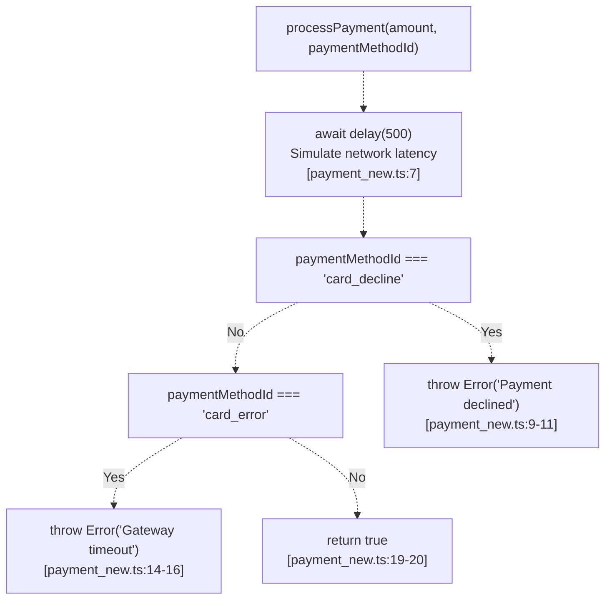
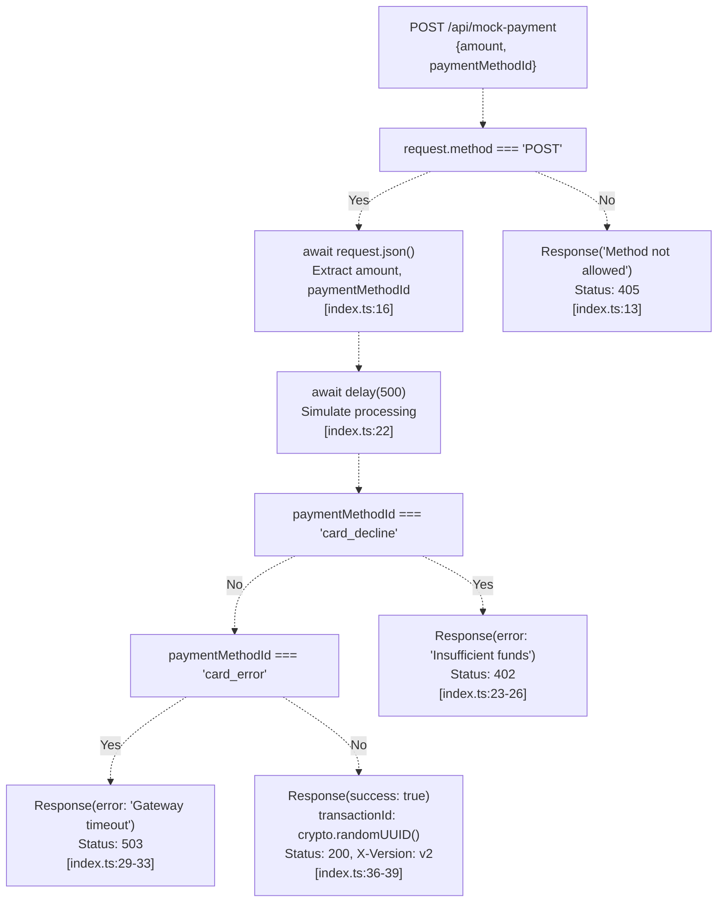
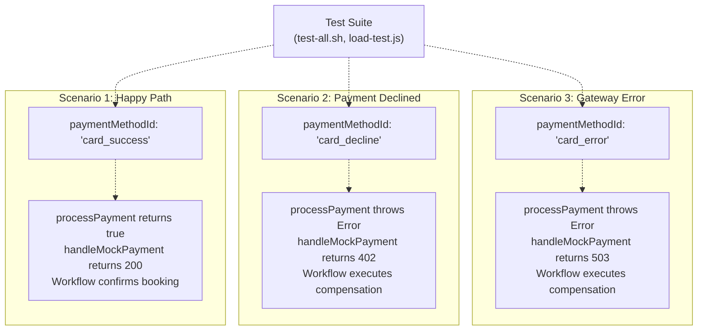
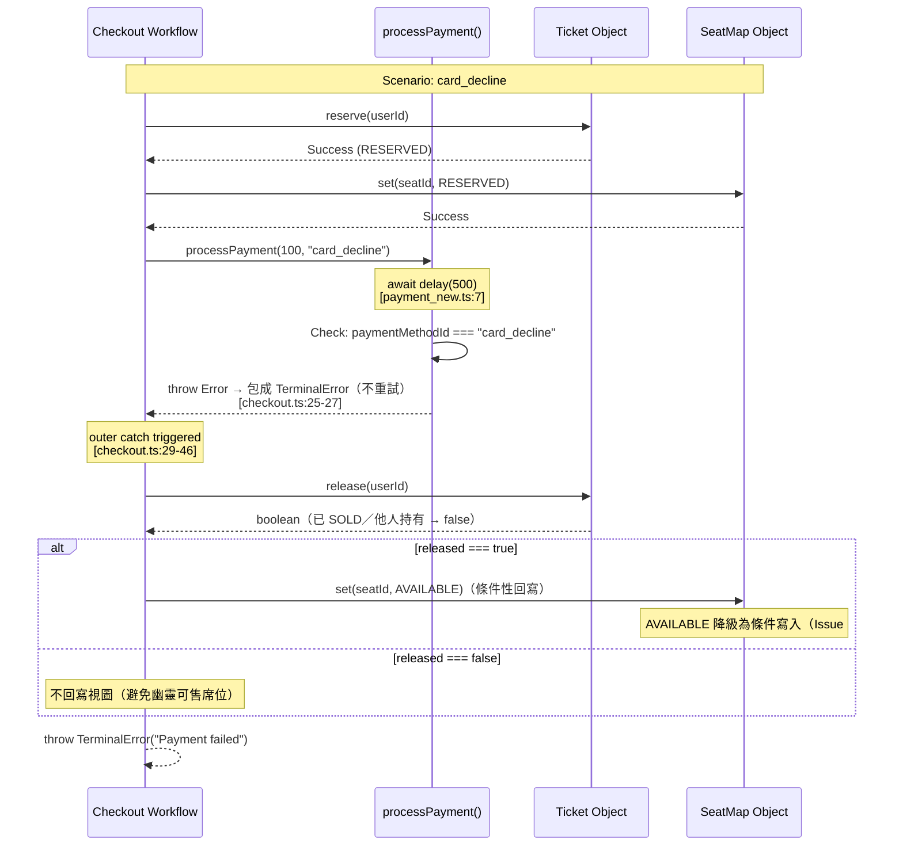

# Payment Simulation

> **Relevant source files**
> * [src/checkout.ts](https://github.com/philipz/restate-cloudflare-workers-poc/blob/513fd0f5/src/checkout.ts)
> * [src/index.ts](https://github.com/philipz/restate-cloudflare-workers-poc/blob/513fd0f5/src/index.ts)
> * [src/utils/payment_new.ts](https://github.com/philipz/restate-cloudflare-workers-poc/blob/513fd0f5/src/utils/payment_new.ts)
> * [src/utils/delay.ts](../../src/utils/delay.ts)
> * [test/payment_new.test.ts](../../test/payment_new.test.ts)
> * [test/delay.test.ts](../../test/delay.test.ts)

## Purpose and Scope

This document details the payment simulation system used for testing and development in the nexus-poc ticketing application. The system provides two complementary simulation mechanisms: a `processPayment` utility function and a mock payment gateway endpoint. These components allow the Checkout workflow to test payment processing logic, error handling, and saga compensation patterns without requiring integration with real payment providers.

For information about how payment simulation integrates into the booking flow, see [Checkout Workflow](/philipz/restate-cloudflare-workers-poc/2.3-checkout-workflow). For testing strategies that utilize these simulations, see [Testing Strategy](/philipz/restate-cloudflare-workers-poc/5-testing-strategy).

---

## Architecture Overview

The payment simulation system consists of two independent components that can be used separately or together:

| Component | Location | Purpose | Invocation Method |
| --- | --- | --- | --- |
| `processPayment` Function | `src/utils/payment_new.ts` | In-process payment simulation for workflow testing | Direct function call within `ctx.run` |
| `handleMockPayment` Endpoint | `src/index.ts` | HTTP endpoint simulating external payment gateway | HTTP POST to `/api/mock-payment` |

### Component Selection Diagram



**Sources:** [src/checkout.ts L22-L28](https://github.com/philipz/restate-cloudflare-workers-poc/blob/513fd0f5/src/checkout.ts#L22-L28)

 [src/utils/payment_new.ts L1-L19](https://github.com/philipz/restate-cloudflare-workers-poc/blob/513fd0f5/src/utils/payment_new.ts#L1-L19)

 [src/index.ts L11-L40](https://github.com/philipz/restate-cloudflare-workers-poc/blob/513fd0f5/src/index.ts#L11-L40)

---

## processPayment Function

The `processPayment` function provides in-process payment simulation. It is invoked within the Checkout workflow's `ctx.run` block, whose result is journaled by Restate: once journaled, replay after a crash reuses the journaled result and the payment is not executed again. Note that this is **at-least-once**, not exactly-once, semantics—a crash *before* the result is journaled causes the closure to be re-executed on replay. See [錯誤分類與重試語意](#錯誤分類與重試語意現況) below.

### Function Signature

```
processPayment(amount: number, paymentMethodId: string): Promise<boolean>
```

**Location:** [src/utils/payment_new.ts L1](https://github.com/philipz/restate-cloudflare-workers-poc/blob/513fd0f5/src/utils/payment_new.ts#L1-L1)

### Payment Method Behaviors

The function simulates three distinct payment outcomes based on the `paymentMethodId` parameter:

| Payment Method ID | Behavior | Latency | Return Value | Error Type |
| --- | --- | --- | --- | --- |
| `card_success` | Payment succeeds | 500ms | `true` | None |
| `card_decline` | Payment declined by gateway | 500ms | N/A | `Error("Payment declined (Method: card_decline)")` |
| `card_error` | Gateway timeout/unavailable | 500ms | N/A | `Error("Gateway timeout")` |
| Any other value | Treated as success | 500ms | `true` | None |

現況補充（繁體中文，Issue #95）：

* 除上述三種保留值外，**其他任何 `paymentMethodId` 一律視為成功**回傳 `true`（payment_new.ts:9–20 只比對 `card_decline` 與 `card_error` 兩個字串）。
* Checkout handler 對請求參數做預設值解構：`paymentMethodId = "card_success"`（checkout.ts:10）——請求未帶付款方式使用時走成功路徑。
* `amount` 參數**完全不參與決策**，只進 log：0、負數、非數字標識之金額照樣成功。此邊界行為由 `test/payment_new.test.ts` 的既有測試鎖住（決策完全取決於 `paymentMethodId`）。
* 延遲並非直接內嵌 `setTimeout`，而是呼叫可注入的 `delay(500)`（payment_new.ts:7，實作見 `src/utils/delay.ts`）；測試環境下延遲被全域歸零，見下文「Latency Simulation」。

### Decision Flow Diagram



**Sources:** [src/utils/payment_new.ts L1-L19](https://github.com/philipz/restate-cloudflare-workers-poc/blob/513fd0f5/src/utils/payment_new.ts#L1-L19)

 **現況行號**：`delay(500)` 在 payment_new.ts:7，`card_decline` 分支 L9–L12，`card_error` 分支 L14–L17，成功回傳 L19–L20（上方節點標註以現況為準）。

### Latency Simulation

All payment outcomes include a consistent 500ms delay to simulate realistic network latency. The current implementation routes the wait through the injectable delay abstraction (`src/utils/delay.ts`) instead of an inlined `setTimeout`:

```typescript
await delay(500); // Simulate 500ms latency（測試可經 setDelayImpl 歸零）
```

**Location:** [src/utils/payment_new.ts:7](../../src/utils/payment_new.ts)

**測試環境的歸零方式**：`test/loader/test-setup.mjs` 在測試啟動時全域呼叫 `setDelayImpl(() => Promise.resolve())`，因此 `delay(500)` 在測試期間立即 resolve，不再建立計時器；未被注入時預設實作等價於原本的 `await new Promise(resolve => setTimeout(resolve, ms))`，正式環境行為不變。延遲長度本身從未被任何測試斷言，被驗證的是回傳值與拋錯型別（見 `test/payment_new.test.ts`；延遲機制本身的契約測試見 `test/delay.test.ts`）。完整說明見 [Utilities & Supporting Services — Injectable delay](./Utilities-&-Supporting-Services.md)。

This delay is critical for testing:

* Workflow idempotency during replay scenarios
* Timeout handling in concurrent operations
* User experience under load conditions

### Integration with Checkout Workflow

The Checkout workflow invokes `processPayment` within a `ctx.run` block so the result is journaled and not re-executed on replay (at-least-once, not exactly-once—see [錯誤分類與重試語意](#錯誤分類與重試語意現況)):

```javascript
await ctx.run("process-payment", async () => {
    try {
        return await processPayment(100, paymentMethodId);
    } catch (e) {
        throw new restate.TerminalError(`Payment declined: ${(e as Error).message}`);
    }
});
```

**Location:** [src/checkout.ts:22-28](../../src/checkout.ts)

Key architectural points:

* `ctx.run` 的結果寫入 journal 後，重放（replay）會直接使用 journaled result 而不再執行閉包——扣款成功後崩潰、重放不會再扣一次；但若崩潰發生在結果寫入之前，重放會再執行閉包一次，故語意是 **at-least-once**（`processPayment` 不帶冪等鍵，重放可能重複扣款，此風險分析見 [Saga Pattern & Compensation](./Saga-Pattern-&-Compensation.md) R4）
* Exceptions are caught and wrapped in `TerminalError` to trigger saga compensation（不重試，詳見下文錯誤分類）
* The `amount` is hardcoded to `100` in the workflow, representing ticket price

**Sources:** [src/checkout.ts L22-L28](https://github.com/philipz/restate-cloudflare-workers-poc/blob/513fd0f5/src/checkout.ts#L22-L28)

 [src/utils/payment_new.ts L1-L19](https://github.com/philipz/restate-cloudflare-workers-poc/blob/513fd0f5/src/utils/payment_new.ts#L1-L19)

---

## handleMockPayment HTTP Endpoint

The `handleMockPayment` function provides an HTTP endpoint that simulates an external payment gateway. This allows testing HTTP integration patterns and external service invocation.

### Endpoint Specification

| Property | Value |
| --- | --- |
| Path | `/api/mock-payment` |
| Method | `POST` |
| Content-Type | `application/json` |
| Request Body | `{ amount: number, paymentMethodId: string }` |
| Handler Function | `handleMockPayment` |
| Location | [src/index.ts L11-L40](https://github.com/philipz/restate-cloudflare-workers-poc/blob/513fd0f5/src/index.ts#L11-L40) |

### Request Routing

The endpoint is routed before Restate handler invocation:

```javascript
export default {
    fetch: async (request: Request, env: any, ctx: any) => {
        const url = new URL(request.url);
        if (url.pathname === "/api/mock-payment") {
            return handleMockPayment(request);
        }
        return restateHandler(request, env, ctx);
    },
};
```

**Location:** [src/index.ts L42-L50](https://github.com/philipz/restate-cloudflare-workers-poc/blob/513fd0f5/src/index.ts#L42-L50)

This routing pattern ensures mock payment requests bypass Restate's durable execution engine entirely.

### Response Status Codes

The endpoint returns different HTTP status codes based on `paymentMethodId`:

| Payment Method ID | HTTP Status | Response Body | Headers |
| --- | --- | --- | --- |
| `card_success` | `200 OK` | `{ success: true, transactionId: <uuid> }` | `X-Version: v2` |
| `card_decline` | `402 Payment Required` | `{ error: "Insufficient funds" }` | Standard |
| `card_error` | `503 Service Unavailable` | `{ error: "Gateway timeout" }` | Standard |

### Response Generation Flow



**Sources:** [src/index.ts L11-L40](https://github.com/philipz/restate-cloudflare-workers-poc/blob/513fd0f5/src/index.ts#L11-L40)

### Transaction ID Generation

Successful payments generate a unique transaction identifier using the Web Crypto API:

```
{ success: true, transactionId: crypto.randomUUID() }
```

**Location:** [src/index.ts L36](https://github.com/philipz/restate-cloudflare-workers-poc/blob/513fd0f5/src/index.ts#L36-L36)

This simulates real payment gateway behavior where each successful transaction receives a unique tracking identifier.

### HTTP Method Validation

The endpoint enforces POST-only access:

```
if (request.method !== "POST") {
    return new Response("Method not allowed", { status: 405 });
}
```

**Location:** [src/index.ts L12-L14](https://github.com/philipz/restate-cloudflare-workers-poc/blob/513fd0f5/src/index.ts#L12-L14)

**Sources:** [src/index.ts L11-L40](https://github.com/philipz/restate-cloudflare-workers-poc/blob/513fd0f5/src/index.ts#L11-L40)

---

## Testing Payment Outcomes

Both simulation components support three deterministic test scenarios controlled by the `paymentMethodId` parameter.

### Test Scenario Mapping



**Sources:** [src/utils/payment_new.ts L7-L14](https://github.com/philipz/restate-cloudflare-workers-poc/blob/513fd0f5/src/utils/payment_new.ts#L7-L14)

 [src/index.ts L22-L34](https://github.com/philipz/restate-cloudflare-workers-poc/blob/513fd0f5/src/index.ts#L22-L34)

### Load Test Distribution

The K6 load testing scripts use a probabilistic distribution of payment outcomes:

| Payment Method | Probability | Purpose |
| --- | --- | --- |
| `card_success` | 80% | Validate happy path performance |
| `card_decline` | 10% | Exercise compensation logic under load |
| `card_error` | 10% | Test error handling and retry behavior |

This distribution is configured in the load test scripts (see [Load Testing](/philipz/restate-cloudflare-workers-poc/5.3-load-testing) for implementation details).

**Sources:** [src/utils/payment_new.ts L1-L19](https://github.com/philipz/restate-cloudflare-workers-poc/blob/513fd0f5/src/utils/payment_new.ts#L1-L19)

 [src/index.ts L11-L40](https://github.com/philipz/restate-cloudflare-workers-poc/blob/513fd0f5/src/index.ts#L11-L40)

---

## Error Handling Patterns

### Terminal vs Retriable Errors

The Checkout workflow wraps payment errors in `TerminalError` to prevent automatic retries:

```
catch (e) {
    throw new restate.TerminalError(`Payment declined: ${(e as Error).message}`);
}
```

**Location:** [src/checkout.ts:26](../../src/checkout.ts)

This pattern ensures that:

* Declined payments (`card_decline`) do not retry infinitely
* Gateway timeouts (`card_error`) trigger immediate compensation——注意 `card_error` 擲出的 `Error("Gateway timeout")` 同樣在內層 try-catch 被包成 `TerminalError`（checkout.ts:25–27），因此**在 workflow 脈絡內它不會被 Restate 重試**；「測試錯誤處理與重試行為」指的是 load test 層面觀察 invocation 的整體行為（見下方重試語意）
* The saga pattern executes cleanup logic (ticket release) exactly once——補償對虛擬物件的呼叫（`release`、`set`）本身由 Restate journal 化，重放時不會重複執行；但釋放成功與否決定是否回寫視圖（見下圖）

### 錯誤分類與重試語意（現況）

**錯誤的兩條路徑**（checkout.ts:22–46）：

1. **付款例外 → `TerminalError`（不重試、走補償）**：`ctx.run("process-payment")` 閉包內（checkout.ts:22–28），`processPayment` 擲出的任何 `Error`（`card_decline`／`card_error`／其他例外）都被內層 try-catch 包成 `restate.TerminalError`。`TerminalError` 向 Restate 表示**永久性失敗**：server 不再重試這個 invocation；例外向外冒泡到外層 catch（checkout.ts:29–46），依序執行補償——釋放票券、（僅在釋放成功時）回寫 SeatMap 為 `AVAILABLE`——再以另一個 `TerminalError`（`Payment failed: ...`）終止整個工作流。
2. **瞬時（非 Terminal）失敗 → 重試政策＋重放**：若閉包或 handler 向外拋出的是普通 `Error`，或發生基礎設施層失敗（Worker 崩潰、暫停、與 server 的連線中斷），Restate 依重試政策重試整個 invocation。重試的實作方式是**重放（replay）**：從頭重新執行 handler，但已寫入 journal 的 `ctx.run` 結果直接重用、不再執行閉包，只有尚未 journal 化的步驟會真正再跑一次。

**journal 重放語意（at-least-once）**：

| 崩潰時機 | 重放行為 | 對扣款的影響 |
| --- | --- | --- |
| `ctx.run("process-payment")` 結果**已寫入 journal** | 閉包不再執行，直接使用 journaled result | 不會再扣款 |
| 結果**寫入 journal 之前**崩潰 | 閉包重新執行 | **可能重複扣款**——`processPayment` 不帶冪等鍵；完整風險分析見 [Saga Pattern & Compensation](./Saga-Pattern-&-Compensation.md) 的 R4 |

因此本文件其餘段落提及的「exactly-once」應理解為：**已確認完成的步驟在重放時不再重複執行**；每個 `ctx.run` 閉包的實際執行次數下限是 1、上限不受保證——語意是 **at-least-once**。

**本 repo 未設定 retryPolicy——瞬時錯誤套用 Restate server 預設重試政策**：`src/` 內沒有任何 service 級或 handler 級的 `retryPolicy`／`options` 宣告（`restate.service({ name, handlers })`，checkout.ts:6–8），因此未包成 `TerminalError` 的失敗由 server 端預設值處理。依官方文件 [Service Configuration — Retries](https://docs.restate.dev/services/configuration)（查證日期 2026-10-19），預設為指數型退避（exponential back-off）：

```toml
[invocation.default-retry-policy]
initial-interval = "50ms"
exponentiation-factor = 2.0
max-attempts = 70
max-interval = "60s"
on-max-attempts = "pause"   # 嘗試耗盡後暫停 invocation，需手動 resume；亦可設 "kill" 直接終端失敗
```

> ⚠️ **版本註記**：README 以 `docker.io/restatedev/restate:latest` 啟動本地 Restate server（README.md:37），**未鎖定版號**；上表是查證當日的官方文件預設值，可能隨 server 版本變動。核對實際值請以部署時拉到的 image 版本對應的文件為準。

### Compensation Trigger Flow



**Sources:** [src/checkout.ts:20-46](../../src/checkout.ts)

 [src/utils/payment_new.ts L7-L14](https://github.com/philipz/restate-cloudflare-workers-poc/blob/513fd0f5/src/utils/payment_new.ts#L7-L14)

---

## Logging and Observability

Both simulation components include structured logging for debugging and monitoring.

### processPayment Logging

```javascript
console.log(`[DEBUG] Processing payment of $${amount} with method: ${paymentMethodId}`);
// ... later ...
console.log("Payment declined by gateway");
// or
console.log("Payment gateway timeout");
// or
console.log("Payment successful");
```

**Locations:** [src/utils/payment_new.ts L2](https://github.com/philipz/restate-cloudflare-workers-poc/blob/513fd0f5/src/utils/payment_new.ts#L2-L2)

 [src/utils/payment_new.ts L8](https://github.com/philipz/restate-cloudflare-workers-poc/blob/513fd0f5/src/utils/payment_new.ts#L8-L8)

 [src/utils/payment_new.ts L13](https://github.com/philipz/restate-cloudflare-workers-poc/blob/513fd0f5/src/utils/payment_new.ts#L13-L13)

 [src/utils/payment_new.ts L17](https://github.com/philipz/restate-cloudflare-workers-poc/blob/513fd0f5/src/utils/payment_new.ts#L17-L17)

### handleMockPayment Logging

```javascript
console.log(`[MockGateway] Processing payment: $${body.amount} via ${body.paymentMethodId}`);
```

**Location:** [src/index.ts L17](https://github.com/philipz/restate-cloudflare-workers-poc/blob/513fd0f5/src/index.ts#L17-L17)

These logs enable correlation between:

* Checkout workflow invocations
* Payment processing attempts
* Compensation execution
* Load test results

**Sources:** [src/utils/payment_new.ts L1-L19](https://github.com/philipz/restate-cloudflare-workers-poc/blob/513fd0f5/src/utils/payment_new.ts#L1-L19)

 [src/index.ts L11-L40](https://github.com/philipz/restate-cloudflare-workers-poc/blob/513fd0f5/src/index.ts#L11-L40)

---

## Design Rationale

### Why Two Simulation Mechanisms?

The dual-component design serves distinct testing purposes:

| Aspect | `processPayment` | `handleMockPayment` |
| --- | --- | --- |
| **Execution Context** | In-process, synchronous | External HTTP, asynchronous |
| **Restate Integration** | Wrapped in `ctx.run` | Bypasses Restate entirely |
| **Testing Focus** | Workflow idempotency, saga patterns | HTTP client behavior, network errors |
| **Performance** | Minimal overhead (500ms delay only) | Includes HTTP serialization/deserialization |
| **Deployment** | Always available | Requires Worker deployment |

### Why 500ms Latency?

The fixed 500ms delay simulates realistic payment gateway response times while remaining fast enough for rapid test execution. This value:

* Matches typical credit card authorization latencies (200-800ms)
* Is long enough to expose race conditions during concurrent testing
* Is short enough to complete 1000+ load test requests within reasonable time frames

### Why Hardcoded Amount?

The Checkout workflow hardcodes the payment amount to `100`:

```
return await processPayment(100, paymentMethodId);
```

**Location:** [src/checkout.ts L24](https://github.com/philipz/restate-cloudflare-workers-poc/blob/513fd0f5/src/checkout.ts#L24-L24)

This simplification is appropriate for the proof-of-concept because:

* Ticket prices are uniform in the demo system
* The focus is testing concurrency and saga patterns, not pricing logic
* Production systems would retrieve amount from ticket state or external pricing service

**Sources:** [src/utils/payment_new.ts L1-L19](https://github.com/philipz/restate-cloudflare-workers-poc/blob/513fd0f5/src/utils/payment_new.ts#L1-L19)

 [src/index.ts L11-L40](https://github.com/philipz/restate-cloudflare-workers-poc/blob/513fd0f5/src/index.ts#L11-L40)

 [src/checkout.ts L22-L28](https://github.com/philipz/restate-cloudflare-workers-poc/blob/513fd0f5/src/checkout.ts#L22-L28)