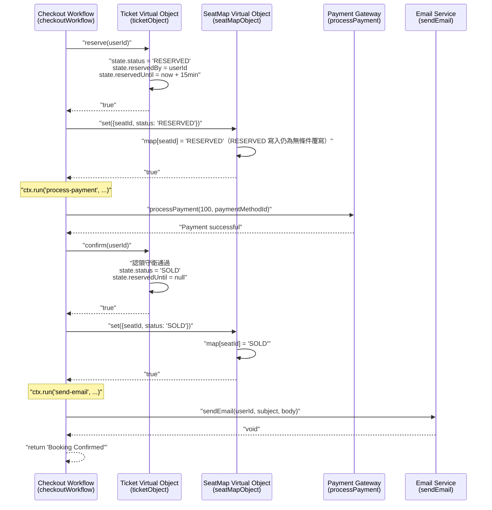
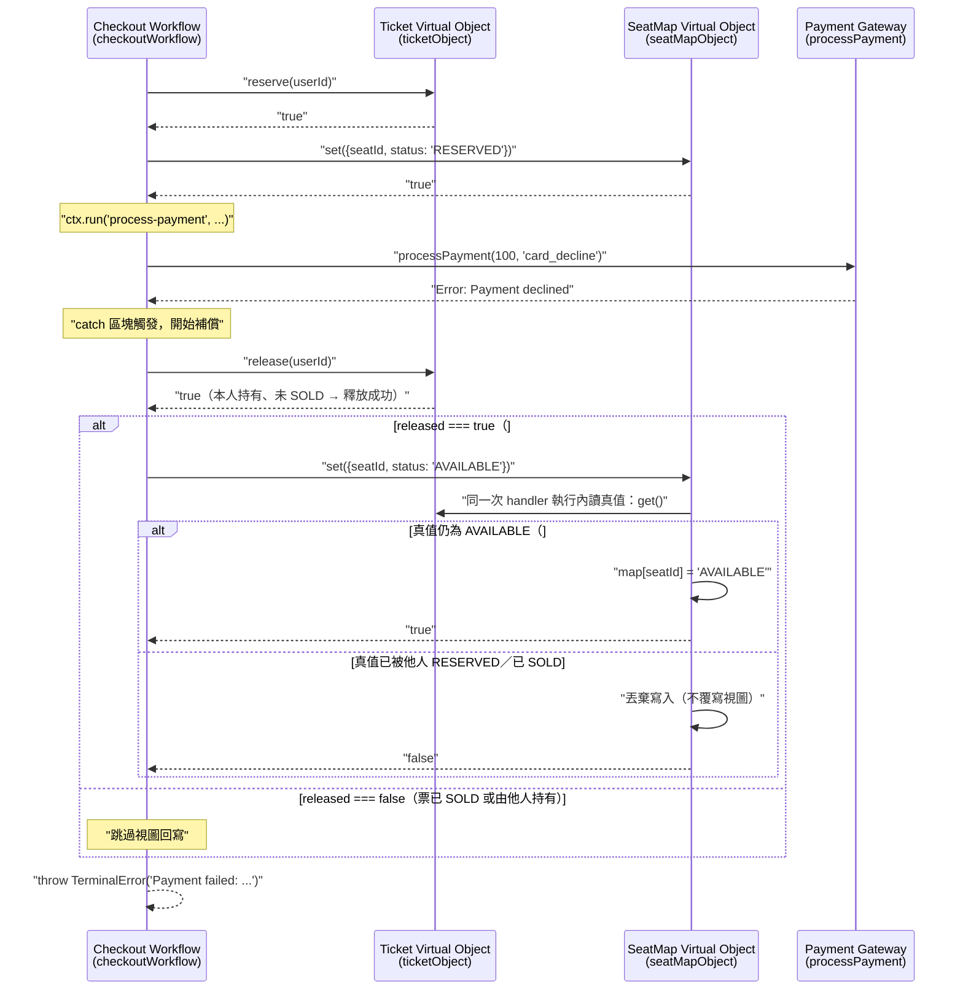
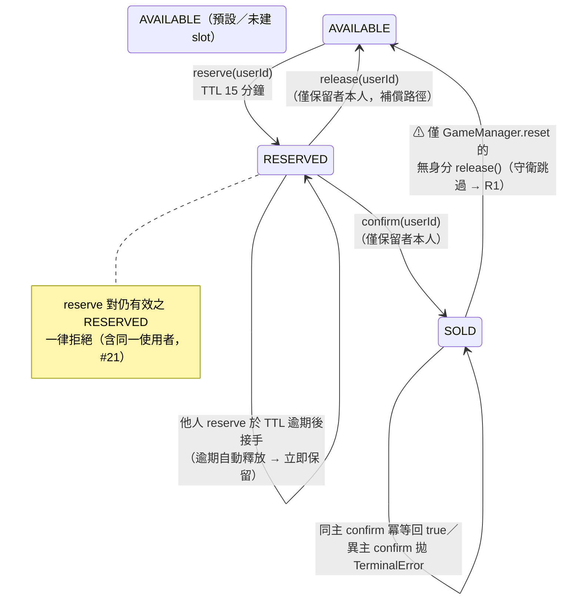
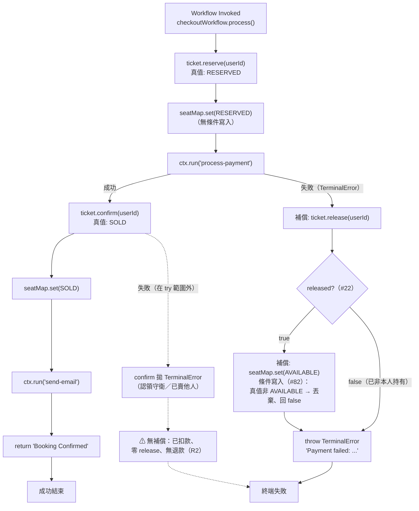

# Saga Pattern & Compensation

> **Relevant source files**
> * [README.md](https://github.com/philipz/restate-cloudflare-workers-poc/blob/513fd0f5/README.md)
> * [src/checkout.ts](https://github.com/philipz/restate-cloudflare-workers-poc/blob/513fd0f5/src/checkout.ts)
> * [src/game.ts](https://github.com/philipz/restate-cloudflare-workers-poc/blob/513fd0f5/src/game.ts)
> * [test/checkout_view_toctou.test.ts](https://github.com/agent-playground/restate-cloudflare-workers-poc/blob/software-factory/test/checkout_view_toctou.test.ts)
> * [test/seatmap_conditional_write.test.ts](https://github.com/agent-playground/restate-cloudflare-workers-poc/blob/software-factory/test/seatmap_conditional_write.test.ts)
> * [docs/research/76-checkout-compensation-concurrency-analysis.md](https://github.com/agent-playground/restate-cloudflare-workers-poc/blob/software-factory/docs/research/76-checkout-compensation-concurrency-analysis.md)

> **本頁現況基準**：內容對齊 `software-factory` 分支的目前實作——含 Issue #22（`release` 回 `true` 才回寫視圖）與 Issue #82（PR #83–#85：`SeatMap.set` 對 `AVAILABLE` 降級改為條件寫入）之後的行為；已知缺口依 AP1 分析報告（Issue #76，`docs/research/76-checkout-compensation-concurrency-analysis.md`）標明實測／推論等級。

## 目的與範圍（Purpose and Scope）

本頁說明 nexus-poc 系統中的 **Saga 模式**實作：`Checkout` workflow 如何在不使用傳統兩階段提交的情況下，跨多個虛擬物件（Virtual Objects）協調多步驟訂票交易，並在失敗時執行補償（compensation）。重點包括：

1. Saga 步驟清單與「失敗時有無補償」的實際邊界；
2. 補償路徑的**現況語意**（#22 的「回 true 才回寫」＋ #82 的條件寫入）與它消除的 TOCTOU 視窗；
3. 補償範圍的**已知缺口**（R2／R1／R4）——僅描述現況，不提出程式修改。

關於 Saga 所編排的虛擬物件，見 [Virtual Objects & Serialization](/philipz/restate-cloudflare-workers-poc/8.1-virtual-objects-and-serialization)；關於持久化執行與重播安全（`ctx.run`），見 [Durable Execution & ctx.run](/philipz/restate-cloudflare-workers-poc/8.2-durable-execution-and-ctx.run)；完整工作流程實作見 [Checkout Workflow](/philipz/restate-cloudflare-workers-poc/2.3-checkout-workflow)。

---

## Saga 模式總覽（Saga Pattern Overview）

nexus-poc 透過 `Checkout` workflow 服務（`src/checkout.ts`）實作 **Saga 模式**來編排多步驟訂票交易。與傳統 ACID 交易在分散式系統間使用鎖不同，Saga 把操作拆解成一串本地交易（local transaction）序列，每個步驟對應一個補償動作，供後續步驟失敗時回退。

### Saga 步驟與「失敗時有無補償」

以目前 `src/checkout.ts`（L9–L59）為準，saga 步驟、效果與失敗時有無補償如下表（缺口詳見後文「補償範圍的已知缺口」）：

| # | 步驟 | 呼叫（行號） | 效果 | 失敗時有無補償 |
|---|---|---|---|---|
| 1a | 保留座位 | `ticket.reserve(userId)`（checkout.ts:16） | Ticket 真值 `AVAILABLE → RESERVED`，TTL 15 分鐘（game.ts:50） | **無**（在 `try` 之外）。reserve 本身拋錯時尚未持有任何東西，無須補償（正確）；但 reserve **成功後**的任何非付款步驟拋錯都不在補償範圍 |
| 1b | 更新聚合視圖 | `seatMap.set(RESERVED)`（checkout.ts:18） | 視圖寫入 `RESERVED` | **無**（在 `try` 之外） |
| 2 | 處理付款 | `ctx.run("process-payment")`（checkout.ts:22–28） | 扣款（模擬 500ms，payment_new.ts:3–21） | **唯一被 `catch` 覆蓋的步驟**：付款失敗 → 進入補償（見下節） |
| 2a | 補償：釋放保留 | `ticket.release(userId)`（checkout.ts:40） | 僅允許「保留者本人」釋放非 SOLD 票券（game.ts:92–99） | — |
| 2b | 補償：回寫視圖 | `seatMap.set(AVAILABLE)`（checkout.ts:41–44，**僅在 2a 回 `true` 時**） | 條件寫入：真值仍非 `AVAILABLE` 時丟棄並回 `false`（game.ts:142–147） | — |
| 2c | 終端失敗 | `throw TerminalError`（checkout.ts:45） | 中止 saga、不再重試 | — |
| 3 | 確認訂票 | `ticket.confirm(userId)`（checkout.ts:49） | Ticket 真值 `RESERVED → SOLD`（認領守衛 game.ts:72–75） | **無任何補償**（在 `try` 之外）——已扣款後此處失敗＝錢票兩空（R2） |
| 4 | 更新聚合視圖 | `seatMap.set(SOLD)`（checkout.ts:51） | 視圖寫入 `SOLD` | **無**（在 `try` 之外） |
| 5 | 發送確認信 | `ctx.run("send-email")`（checkout.ts:54–56） | 發信 | 失敗由 Restate 重試、不影響票券（可接受） |

**關鍵邊界**：補償的 `try/catch`（checkout.ts:20–46）只包住付款步驟。付款**失敗**有對稱的補償（釋放＋條件回寫）；付款**成功之後**的任何失敗（步驟 3/4）完全在補償範圍外，且整個 codebase 沒有任何退款操作（`src/utils/payment_new.ts` 只有扣款方向；全 repo `refund/退款` 出現次數為 0）——這是 R2 缺口的結構成因。

**Sources:** [src/checkout.ts L9–L59](https://github.com/agent-playground/restate-cloudflare-workers-poc/blob/software-factory/src/checkout.ts#L9-L59)、[docs/research/76-checkout-compensation-concurrency-analysis.md §2.1](https://github.com/agent-playground/restate-cloudflare-workers-poc/blob/software-factory/docs/research/76-checkout-compensation-concurrency-analysis.md)

---

## 交易流程（Transaction Flow）

### Happy Path：訂票成功



**Sources:** [src/checkout.ts L15–L58](https://github.com/agent-playground/restate-cloudflare-workers-poc/blob/software-factory/src/checkout.ts#L15-L58)、[src/game.ts L19–L82](https://github.com/agent-playground/restate-cloudflare-workers-poc/blob/software-factory/src/game.ts#L19-L82)

### Failure Path：付款被拒，進入補償（現況含 #22／#82 雙重守衛）



注意：即使回寫被條件寫入丟棄（回 `false`），saga 仍照常拋出 `TerminalError` 終端失敗——丟棄只影響**去正規化視圖**的收斂時機，不影響本票券的補償結果（真值已因 `release` 成功而回到 `AVAILABLE`）。

**Sources:** [src/checkout.ts L29–L46](https://github.com/agent-playground/restate-cloudflare-workers-poc/blob/software-factory/src/checkout.ts#L29-L46)、[src/game.ts L84–L147](https://github.com/agent-playground/restate-cloudflare-workers-poc/blob/software-factory/src/game.ts#L84-L147)

---

## 補償邏輯實作（Compensation Logic Implementation）

### 程式結構

補償邏輯位於 `Checkout.process` handler 的 try-catch：`try` 只包住付款步驟，`catch` 依序執行「釋放票券 → （條件性地）回寫視圖 → 拋出 `TerminalError`」：

```text
Step 1: ticket.reserve(userId)                 # 在 try 之外
Step 2: seatMap.set(RESERVED)                  # 在 try 之外
try {
    Step 3: ctx.run("process-payment")         # 唯一被 catch 覆蓋的步驟
} catch (error) {
    // COMPENSATION PATH（#22 + #82 語意）
    released = await ticket.release(userId)    # 回 true 才繼續回寫
    if (released) {
        await seatMap.set(AVAILABLE)           # 條件寫入：可能被丟棄、回 false
    }
    throw new TerminalError("Payment failed: ...")
}
Step 4: ticket.confirm(userId)                 # 在 try 之外（失敗無補償 → R2）
Step 5: seatMap.set(SOLD)                      # 在 try 之外
Step 6: ctx.run("send-email")
```

**Sources:** [src/checkout.ts L20–L56](https://github.com/agent-playground/restate-cloudflare-workers-poc/blob/software-factory/src/checkout.ts#L20-L56)

### 守衛一（Issue #22）：`release` 回 true 才回寫視圖

補償第一步呼叫 `ticket.release(userId)` 時**帶呼叫者身分**。`Ticket.release` 的守衛（game.ts:92–99）：

* 票已 `SOLD` → 回 `false`（已收款交易不可被補償消滅）；
* 保留者不是呼叫者本人（`reservedBy && reservedBy !== userId`）→ 回 `false`；
* 其餘情況 → 重置為 `AVAILABLE`（`reservedBy`/`reservedUntil` 歸 null）並回 `true`。

`saga` 端（checkout.ts:40–44）**只有在 `released === true` 時**才呼叫 `seatMap.set(AVAILABLE)`。動機：若本 saga 已不再持有該座位（已被他人買下或接管），無條件把視圖寫回 `AVAILABLE` 會以 last-writer-wins 覆蓋他人較新的 `RESERVED`/`SOLD` 寫入，造成持久的「幽靈可售票」。

**Sources:** [src/game.ts L84–L106](https://github.com/agent-playground/restate-cloudflare-workers-poc/blob/software-factory/src/game.ts#L84-L106)、[src/checkout.ts L30–L44](https://github.com/agent-playground/restate-cloudflare-workers-poc/blob/software-factory/src/checkout.ts#L30-L44)

### 守衛二（Issue #82，R3／WI-5）：`SeatMap.set` 對 `AVAILABLE` 降級採**條件寫入**

#22 的守衛仍殘留一個 TOCTOU 窗口（見下節）。#82（PR #83–#85）把防線移到**寫入端**：`SeatMap.set` 收到 `status === "AVAILABLE"` 的降級寫入時（game.ts:142–147），在 **SeatMap 自己的同一次 handler 執行內**先讀取該席 `Ticket` 真值：

* 真值為 `RESERVED`／`SOLD`（此时必屬他人持有或已成交——本人補償路徑的 `release` 已先把真值轉回 `AVAILABLE`）→ **丟棄這次寫入並回傳 `false`**，視圖收斂交給下一次真值事件；
* 真值仍為 `AVAILABLE` → 照常寫入並回 `true`；
* `truth` 為 `undefined` 的情況只可能來自 POC 測試替身的 recorder stub ctx（Restate 環境與整合 harness 中 `Ticket.get` 必回值、未建 slot 落回預設 `AVAILABLE`），此時維持寫入。

**只有 `AVAILABLE` 降級受此條件約束**；`RESERVED`/`SOLD` 的視圖寫入仍是無條件覆寫（game.ts:149–151）。

**Sources:** [src/game.ts L129–L151](https://github.com/agent-playground/restate-cloudflare-workers-poc/blob/software-factory/src/game.ts#L129-L151)

### 條件寫入消除的 TOCTOU 視窗

**修復前（#22 語意，AP1 實測 E3）**：守衛在「檢查當下」評估——`release` 回 `true` 之後、`seatMap.set(AVAILABLE)` 送達之前，第三人可在這個跨兩次虛擬物件呼叫（Ticket → SeatMap）的空檔完成 `reserve` ＋寫入視圖 `RESERVED`；隨後 A 帶著過期判斷的回寫仍以 last-writer-wins 覆蓋視圖 → `view = AVAILABLE` 而真值是他人有效保留（幽靈可售席位；第三人依視圖下單會被 `currently reserved` 擋下）。檢查與寫入分屬兩個物件、兩次網路往返，中間沒有原子性。

**修復後（#82）**：檢查（讀真值）與效果（寫視圖）收斂到 SeatMap 的**同一次 exclusive handler 執行**內，不再分屬兩個跨物件呼叫時點。以第三人接管交錯窮舉：

1. 他人的 `set(RESERVED)` 排在本次條件寫入**之前** → 本寫入執行時讀到真值已非 `AVAILABLE`（對方的 `reserve` 必在其視圖寫入之前提交）→ 丟棄、回 `false`；
2. 排在**之後** → 本寫入可能生效（讀到真值尚為 `AVAILABLE`），但對方緊接著的 `RESERVED` 視圖寫入會把它收斂掉。

兩種次序的最終視圖都與真值一致——**不再產生持久的 `view ≠ truth` 幽靈可售席位**；帶著過期判斷的回寫最壞是被丟棄。AP1 E3 的交錯次序本身仍然合法（交錯窗口沒有消失），改的是「過期回寫不再能覆蓋第三人」——這正是 `test/checkout_view_toctou.test.ts` 在 #82 前後 characterization 的可觀察差異。

**Sources:** [src/checkout.ts L35–L44](https://github.com/agent-playground/restate-cloudflare-workers-poc/blob/software-factory/src/checkout.ts#L35-L44)（修復註解）、[docs/research/76-checkout-compensation-concurrency-analysis.md §3.3](https://github.com/agent-playground/restate-cloudflare-workers-poc/blob/software-factory/docs/research/76-checkout-compensation-concurrency-analysis.md)

### 釘住此語意的測試

* [test/seatmap_conditional_write.test.ts](https://github.com/agent-playground/restate-cloudflare-workers-poc/blob/software-factory/test/seatmap_conditional_write.test.ts)：handler 級三條斷言——(1) 本人 `release` 成功後回寫 `AVAILABLE` 照常生效（合法補償不得 regression）；(2) 真值 `RESERVED` by 他人 → 丟棄過期的 `AVAILABLE` 回寫；(3) 真值 `SOLD` → 丟棄 `AVAILABLE` 回寫（已成交席位不得被覆蓋成可售）。
* [test/checkout_view_toctou.test.ts](https://github.com/agent-playground/restate-cloudflare-workers-poc/blob/software-factory/test/checkout_view_toctou.test.ts)：依 checkout saga 的真實呼叫次序重現交錯（`reserve → set RESERVED → release=true → B 接管 → A 的過期回寫`），釘住「過期回寫被條件寫入丟棄、view 與真值一致」的修復後行為，並含第三人依視圖下單的後續斷言。

---

## 補償範圍的已知缺口（R2／R1／R4）

> 本節**以 AP1 分析報告（Issue #76）為準**、只描述現況缺口，**不提出程式修改**（修復方向與工作項建議見該報告 §5–§6，放行與開單由人類裁定）。
> 證據等級定義（同 AP1 §3）：**【實測】**＝沙箱內以真實 handler 接線的整合式 harness（`test/helpers/integration.ts`）重現；**【推論】**＝由碼路與執行期語意推斷、沙箱無法執行該執行期機制（持久化／重播／多機並行），需生產 Restate E2E 驗證。

| 缺口 | 情境 | 觸發條件 | 現況補償行為 | 證據等級 | 優先序（AP1） |
|---|---|---|---|---|---|
| **R2** | 付款成功後 `confirm` 失敗 | 付款完成與 `confirm` 之間停頓跨越 15 分鐘 TTL，期間他人接管座位 | **不退款、不釋放、不回寫視圖**——已扣款者錢票兩空 | 實測（E2；交錯後果）／生產停頓原因屬推論 | P0 |
| **R1** | auto-reset 雙重銷售 | 任一 `set` 使 `soldCount ≥ 50` → fire-and-forget `GameManager.reset` → 無身分 `release()` | 已 SOLD 票券被無聲清回 `AVAILABLE`，同一座位可被再次完整售出；首位買家無退款／通知 | 實測（E1） | P0 |
| **R4** | 重放重複扣款 | `ctx.run` 結果寫入 journal 前崩潰 → 重放 → `processPayment` 閉包再執行 | 無任何防護：付款不帶冪等鍵、mock gateway 不去重 | **推論**（需生產 E2E） | P1 |

### R2：付款成功後 confirm 失敗——零補償（錢票兩空）

補償 `try` 區塊只包住付款（checkout.ts:20–46）；`ticket.confirm`（L49）與 SOLD 回寫（L51）在範圍之外。E2 實測時序：alice 以 `card_success` 完成扣款後、`confirm` 前停頓，時鐘越過 TTL（game.ts:31–36 的逾期自動釋放），bob 合法 `reserve`＋`confirm` 同座位成功；alice 的 `confirm` 觸認領守衛／已賣他人分支（game.ts:64–75）拋出 `TerminalError`——此路徑上 `release` 呼叫 **0 次**（補償完全不觸發）、不發信、且**沒有退款操作可調用**（repo 內 `refund/退款` 出現次數為 0）。alice 的 100 元滯留，無退款、無補償、無告警事件。生產停頓原因（付款閘道重試、Worker 暫停／冷啟動、invocation 重試）屬推論，但 15 分鐘 TTL 相對正常流程極寬，交錯視窗在生產反而更大。

**Sources:** [src/checkout.ts L20–L51](https://github.com/agent-playground/restate-cloudflare-workers-poc/blob/software-factory/src/checkout.ts#L20-L51)、AP1 §1.1／§3.2

### R1：auto-reset 抹除已成交真值 → 同一座位雙重銷售

`SeatMap.set` 在寫入後統計 `soldCount >= 50`（game.ts:153–167）即 fire-and-forget 觸發 `GameManager.reset`（game_manager.ts:7–17）：後者先以 `seatMapObject.reset()` 清空視圖（game.ts:171–177），再對 seat-1..50 逐一發出**無身分的 `release()`**。`Ticket.release` 的守衛只在 `userId !== undefined` 時檢查（game.ts:92–99），因此**無參數呼叫完全無守衛**——已付款（`SOLD`）的票券被直接清回 `AVAILABLE`。E1 實測：50 席全部完成「扣款＋confirm＋發信」→ auto-reset 投遞 → mallory 對 seat-1 再次完整結帳**成功**（同席第二次 `confirm` 成功、全程 `process-payment` 51 次）；`user-1` 的扣款沒有任何退款或失效通知路徑，其「Booking Confirmed」信件成為虛假憑證。回合制 auto-reset 是刻意設計（`load-test.js` 依賴），湊滿 50 是常態事件。

**Sources:** [src/game.ts L153–L177](https://github.com/agent-playground/restate-cloudflare-workers-poc/blob/software-factory/src/game.ts#L153-L177)、[src/game_manager.ts L7–L17](https://github.com/agent-playground/restate-cloudflare-workers-poc/blob/software-factory/src/game_manager.ts#L7-L17)、AP1 §3.1

### R4：扣款非冪等 × `ctx.run` at-least-once → 崩潰重放可重複扣款【推論】

`processPayment`（payment_new.ts:3–21）不帶冪等鍵；雲端 mock gateway（index.ts:12–35）亦不去重。Restate 的 `ctx.run` 對副作用是 **at-least-once**：結果寫入 journal 前崩潰、重放時閉包會再執行一次——同一筆付款可能被扣兩次。日常「同一票第二人付款」會被 Ticket 狀態機擋下（R1 的重置路徑反而是例外），所以雙扣需要 crash-重放路徑；本沙箱 harness 不模擬持久化／重播，故只能推論，需生產 Restate E2E（`test-all.sh` 範疇）驗證。

**Sources:** [src/utils/payment_new.ts L3–L21](https://github.com/agent-playground/restate-cloudflare-workers-poc/blob/software-factory/src/utils/payment_new.ts#L3-L21)、AP1 §3.4

> 另注：AP1 尚有一條推論級項目 **R5**（「reserve 回覆於 journal 遺失」假設下使用者被自己的幽靈保留鎖 15 分鐘），本頁不展開，見 AP1 §3.5。

---

## Terminal 錯誤與錯誤傳播（Terminal Errors and Error Propagation）

### TerminalError 的使用

本系統的 Saga 用 Restate 的 `TerminalError` 區分可重試失敗（瞬時錯誤）與需要立即中止的永久失敗。`TerminalError` 向 Restate 表示：

1. workflow 已永久失敗；
2. 不應嘗試自動重試；
3. 錯誤應立即回傳給呼叫者。

### 錯誤包裝策略（兩層）

#### 第一層：付款處理（內層包裝）

```javascript
// src/checkout.ts:22-28
await ctx.run("process-payment", async () => {
    try {
        return await processPayment(100, paymentMethodId);
    } catch (e) {
        throw new restate.TerminalError(`Payment declined: ${(e as Error).message}`);
    }
});
```

* **目的：** 在持久化執行脈絡內把付款閘道例外轉換為 `TerminalError`。
* **效果：** 付款失敗不會被 Restate 自動重試。

#### 第二層：補償執行（外層包裝）

```javascript
// src/checkout.ts:29-46（節略）
} catch (error) {
    const released = await ticket.release(userId);   // #22：僅本人持有且未 SOLD 才回 true
    if (released) {
        await seatMap.set({ seatId: ticketId, status: "AVAILABLE" });  // #82：條件寫入，可能被丟棄
    }
    throw new restate.TerminalError(`Payment failed: ${(error as Error).message}`);
}
```

* **目的：** 在 propagate 終端錯誤之前先完成補償動作。
* **效果：** 工作流終止前釋放與（條件性的）視圖回寫已執行；補償步驟本身失敗時由 Restate 重試整個 invocation。

**Sources:** [src/checkout.ts L20–L46](https://github.com/agent-playground/restate-cloudflare-workers-poc/blob/software-factory/src/checkout.ts#L20-L46)

### 錯誤分類

付款模擬系統支援三種情境，Saga 對各自的處理：

| 付款方式 | 錯誤類型 | Saga 行為 | Restate 動作 |
|---|---|---|---|
| `card_success` | 無 | 繼續到確認步驟 | N/A |
| `card_decline` | `TerminalError` | 執行補償 | 立即中止、不重試 |
| `card_error` | Generic `Error`（轉換為 `TerminalError`） | 執行補償 | 立即中止、不重試 |

**註：** checkout.ts L23–L27 的內層 try-catch 確保所有付款錯誤都轉換為 `TerminalError`，使所有付款失敗皆不可重試。生產系統中此設計取捨可能不同——部分付款錯誤（如網路逾時）或應先自動重試再觸發補償。

**Sources:** [src/checkout.ts L22–L28](https://github.com/agent-playground/restate-cloudflare-workers-poc/blob/software-factory/src/checkout.ts#L22-L28)、[README.md](https://github.com/philipz/restate-cloudflare-workers-poc/blob/513fd0f5/README.md)

---

## 狀態轉換模型（State Transition Model）

### Ticket 狀態機

Saga 編排的 `Ticket` 虛擬物件狀態機（含 #21 拒同 user 重複保留、#22 帶身分釋放守衛）：



**Sources:** [src/game.ts L19–L106](https://github.com/agent-playground/restate-cloudflare-workers-poc/blob/software-factory/src/game.ts#L19-L106)

### Saga 執行流



**Sources:** [src/checkout.ts L9–L59](https://github.com/agent-playground/restate-cloudflare-workers-poc/blob/software-factory/src/checkout.ts#L9-L59)

---

## Saga 的保證與限制（Saga Guarantees and Limitations）

### 原子性保證

本系統的 Saga 提供**最終一致性**，保證如下：

1. **單座位原子性：** 每個 Ticket 虛擬物件的狀態轉換因 Restate 的 per-key 序列化而具原子性（見 [Virtual Objects & Serialization](/philipz/restate-cloudflare-workers-poc/8.1-virtual-objects-and-serialization)）。
2. **補償守衛正確性：** 付款失敗時，釋放只在「仍由本人持有且未 SOLD」時發生（#22）；`AVAILABLE` 視圖降級只在「真值此刻仍為 `AVAILABLE`」時生效（#82 條件寫入——檢查與寫入在同一次 exclusive handler 執行內完成），因此補償路徑不再能製造持久的幽靈可售席位。
3. **補償的呼叫端冪等性：** 對同一 saga 的 Restate 重試而言，`release(userId)` 重複執行無額外副作用（第二次會因真值已 `AVAILABLE`、`reservedBy` 為 null 而回 `true` 的 noop 寫入）；被他人接管後則回 `false`，不會誤傷。

### 不提供的保證（Non-Guarantees）

系統**不**提供：

1. **交易隔離：** `reserve()` 到 `confirm()` 之間，座位處於 `RESERVED` 且對其他操作可見（如查詢）。
2. **即時視圖一致：** SeatMap 是去正規化視圖，與 Ticket 真值的同步分散在 saga 的多次獨立呼叫之間；條件寫入消除的是「過期回寫覆蓋他人」這一類**持久**偏差，寫入被丟棄時視圖仍要等下一次真值事件才收斂。
3. **分散式回滚：** 補償步驟本身失敗（如 `release()` 期間網路分隔）由 Restate 重試，但跨物件沒有交易性回滚。
4. **付款後的補償：** `try` 只包付款；已扣款後的失敗（`confirm`、SOLD 回寫）**不觸發任何補償**、亦無退款操作存在——這是上表 R2 的範圍，並非本頁要掩蓋的「保證」。

### 補償順序

補償依 forward 操作的**逆序**執行：

```text
Forward:  reserve(userId) → seatMap.set(RESERVED) → payment
Backward:                 seatMap.set(AVAILABLE) ← release(userId)
                          （逆序呼叫，但 set 受 release 回傳值門控）
```

順序保證：

* 真值來源（`Ticket` 狀態）先被回退；
* 聚合視圖（`SeatMap`）在其後更新，且寫入前重新核對真值——檢查與寫入收斂在 SeatMap 的同一次 handler 執行內。

**Sources:** [src/checkout.ts L29–L46](https://github.com/agent-playground/restate-cloudflare-workers-poc/blob/software-factory/src/checkout.ts#L29-L46)、[src/game.ts L132–L151](https://github.com/agent-playground/restate-cloudflare-workers-poc/blob/software-factory/src/game.ts#L132-L151)

---

## 比較：Saga vs. 兩階段提交（Two-Phase Commit）

下表對比 nexus-poc 的 Saga 實作與傳統 2PC：

| 構面 | Saga Pattern（nexus-poc） | Two-Phase Commit |
|---|---|---|
| **協調方式** | 以 workflow 步驟編排（choreography） | 中央協調者＋prepare/commit 階段 |
| **失敗處理** | 程式碼中顯式補償邏輯（僅覆蓋付款步驟） | 交易管理員自動回滚 |
| **隔離性** | 無隔離——執行期間狀態可見 | commit 前完整隔離 |
| **效能** | 高——步驟間不持有分散式鎖 | 低——需要分散式鎖 |
| **複雜度** | 開發者實作補償 | 交易管理員處理回滚 |
| **實作位置** | [src/checkout.ts L29–L46](https://github.com/agent-playground/restate-cloudflare-workers-poc/blob/software-factory/src/checkout.ts#L29-L46) | N/A（未使用） |
| **適用情境** | 高併發、可接受最終一致性的售票 | 需要強一致性的銀行系統 |

本系統刻意以 Saga 取代 2PC，理由是：

* **高吞吐：** 15 分鐘保留窗口期間不持有分散式鎖；
* **部分失敗韌性：** 單張票的保留失敗不阻塞其他票；
* **Cloudflare Workers 相容性：** 無狀態執行模型與 Saga 編排天然契合。

**Sources:** [src/checkout.ts L9–L59](https://github.com/agent-playground/restate-cloudflare-workers-poc/blob/software-factory/src/checkout.ts#L9-L59)、[README.md L1–L16](https://github.com/philipz/restate-cloudflare-workers-poc/blob/513fd0f5/README.md#L1-L16)
