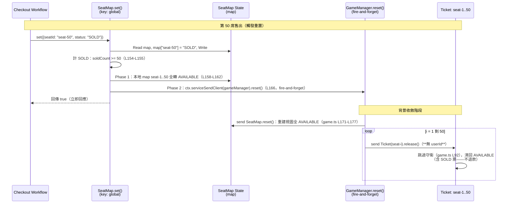
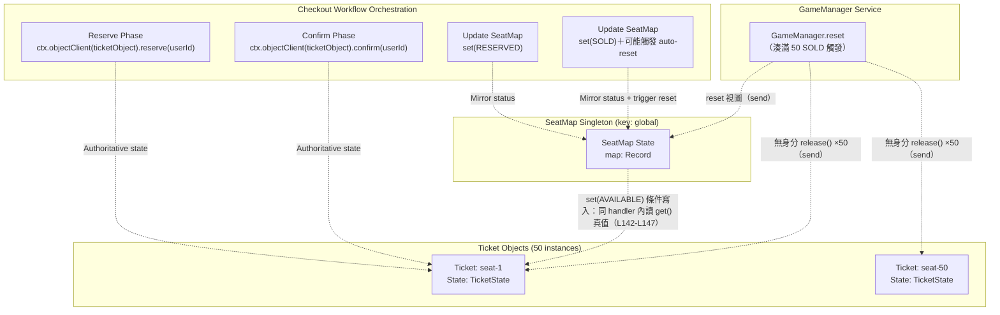
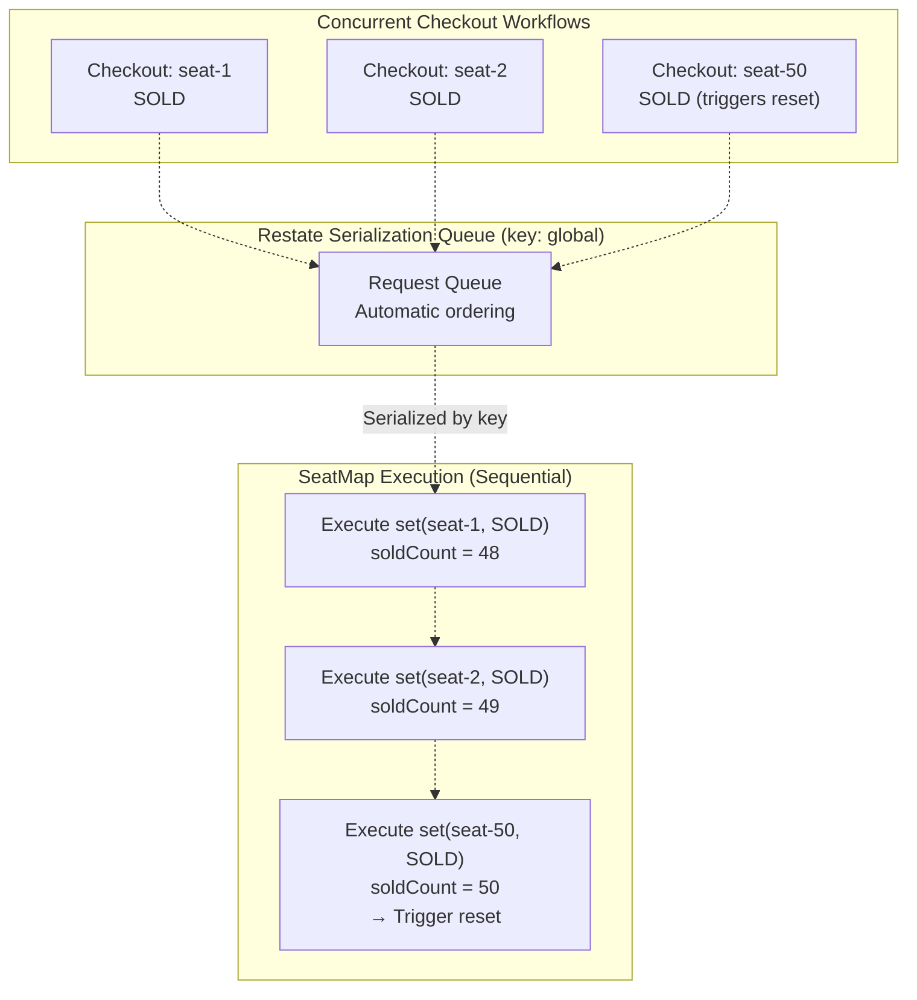

# SeatMap Virtual Object

> **Relevant source files**
> * [README.md](https://github.com/philipz/restate-cloudflare-workers-poc/blob/513fd0f5/README.md)
> * [src/game.ts](https://github.com/agent-playground/restate-cloudflare-workers-poc/blob/abf3d0d/src/game.ts)
> * [src/game_manager.ts](https://github.com/agent-playground/restate-cloudflare-workers-poc/blob/abf3d0d/src/game_manager.ts)
> * [test/game_seatmap.test.ts](https://github.com/agent-playground/restate-cloudflare-workers-poc/blob/abf3d0d/test/game_seatmap.test.ts)
> * [test/seatmap_conditional_write.test.ts](https://github.com/agent-playground/restate-cloudflare-workers-poc/blob/abf3d0d/test/seatmap_conditional_write.test.ts)
> * [test/game_manager.test.ts](https://github.com/agent-playground/restate-cloudflare-workers-poc/blob/abf3d0d/test/game_manager.test.ts)
> * [test/game_manager_reset_resale.test.ts](https://github.com/agent-playground/restate-cloudflare-workers-poc/blob/abf3d0d/test/game_manager_reset_resale.test.ts)

## Purpose and Scope

**SeatMap 虛擬物件**為票券系統的所有席位提供聚合狀態管理。它是席位真值（Ticket）之上的**視圖（view）**，維護全部座位狀態的全域映像，並實作湊滿 50 席 `SOLD` 時的自動重置（回合重置）機制。

本文涵蓋 SeatMap 的狀態結構、三個 handler（`set`／`reset`／`get`）、Issue #82 的**條件寫入**，以及自動重置機制。關於單一座位的真值狀態機與序列化保證，請見 [Ticket Virtual Object](/philipz/restate-cloudflare-workers-poc/2.1-ticket-virtual-object)；關於 Checkout workflow 如何與 SeatMap 互動，請見 [Checkout Workflow](/philipz/restate-cloudflare-workers-poc/2.3-checkout-workflow)。

**Sources:** [src/game.ts L129-L183](https://github.com/agent-playground/restate-cloudflare-workers-poc/blob/abf3d0d/src/game.ts#L129-L183)

---

## Virtual Object Architecture

SeatMap 以 Restate 虛擬物件實作，為單例模式：不同於 Ticket 每席一個實例（keyed by `seatId`），SeatMap 只有一個以 `"global"` 為 key 的全域實例（呼叫端見 [src/checkout.ts L13](https://github.com/agent-playground/restate-cloudflare-workers-poc/blob/abf3d0d/src/checkout.ts#L13-L13)、[src/game_manager.ts L11](https://github.com/agent-playground/restate-cloudflare-workers-poc/blob/abf3d0d/src/game_manager.ts#L11-L11)）。

### Object Definition

```yaml
Object Name: "SeatMap"        # src/game.ts L130
Key: "global" (singleton)
State: map: Record<string, string>
```

物件以 `restate.object()` 定義於 [src/game.ts L129-L183](https://github.com/agent-playground/restate-cloudflare-workers-poc/blob/abf3d0d/src/game.ts#L129-L183)，暴露三個 handlers：`set`（[L132-L170](https://github.com/agent-playground/restate-cloudflare-workers-poc/blob/abf3d0d/src/game.ts#L132-L170)）、`reset`（[L171-L177](https://github.com/agent-playground/restate-cloudflare-workers-poc/blob/abf3d0d/src/game.ts#L171-L177)）、`get`（[L178-L181](https://github.com/agent-playground/restate-cloudflare-workers-poc/blob/abf3d0d/src/game.ts#L178-L181)）。

> 註：舊版文件描述的 `resetAll` handler 已不存在於現行 `src/game.ts`——視圖重建是 `reset`，票券真值的批次釋放則由獨立的 `GameManager` 服務負責（[src/game_manager.ts L4-L20](https://github.com/agent-playground/restate-cloudflare-workers-poc/blob/abf3d0d/src/game_manager.ts#L4-L20)）。

**Sources:** [src/game.ts L129-L183](https://github.com/agent-playground/restate-cloudflare-workers-poc/blob/abf3d0d/src/game.ts#L129-L183)

---

## State Structure

SeatMap 以單一狀態變數 `map` 聚合所有席位狀態。

| State Key | Type | Description |
| --- | --- | --- |
| `map` | `Record<string, string>` | 鍵為席位 ID（如 `"seat-1"`）、值為狀態字串（`"AVAILABLE"`、`"RESERVED"`、`"SOLD"`）的鍵值對 |

### State Access Pattern

```javascript
const map = (await ctx.get<Record<string, string>>("map")) || {};
```

狀態以 `ctx.get()` 讀取，尚無狀態時預設空物件。此模式出現在 `set`（[L149](https://github.com/agent-playground/restate-cloudflare-workers-poc/blob/abf3d0d/src/game.ts#L149-L149)）與 `get`（[L179](https://github.com/agent-playground/restate-cloudflare-workers-poc/blob/abf3d0d/src/game.ts#L179-L179)）；`reset`（L172-L176）則直接重建一個 seat-1..50 全 `AVAILABLE` 的新 map 而不讀舊值。

**Sources:** [src/game.ts L149](https://github.com/agent-playground/restate-cloudflare-workers-poc/blob/abf3d0d/src/game.ts#L149-L149), [src/game.ts L171-L177](https://github.com/agent-playground/restate-cloudflare-workers-poc/blob/abf3d0d/src/game.ts#L171-L177), [src/game.ts L179](https://github.com/agent-playground/restate-cloudflare-workers-poc/blob/abf3d0d/src/game.ts#L179-L179)

---

## Handler Methods

### set Handler

`set` 更新聚合 map 中單一席位的狀態，必要時觸發自動重置。它是 SeatMap 最複雜的 handler：**對 `AVAILABLE` 降級的寫入是條件寫入**（Issue #82）。

**Signature:** `set(ctx: restate.ObjectContext, data: { seatId: string, status: string })`（[L132](https://github.com/agent-playground/restate-cloudflare-workers-poc/blob/abf3d0d/src/game.ts#L132-L132)）

**Implementation Flow:**

1. **條件寫入檢查**（僅當 `data.status === "AVAILABLE"`）：在**同一次 handler 執行**內，以 `ctx.objectClient(ticketObject, data.seatId).get()` 讀取該席 Ticket 真值（[L142-L143](https://github.com/agent-playground/restate-cloudflare-workers-poc/blob/abf3d0d/src/game.ts#L142-L143)）。真值仍由他人持有（`RESERVED`／`SOLD`）時**丟棄寫入並回傳 `false`**（[L144-L146](https://github.com/agent-playground/restate-cloudflare-workers-poc/blob/abf3d0d/src/game.ts#L144-L146)）——視圖收斂交給下一次真值事件。
2. 讀取目前 map（[L149](https://github.com/agent-playground/restate-cloudflare-workers-poc/blob/abf3d0d/src/game.ts#L149-L149)）、寫入該席狀態（L150）、持久化（L151）。
3. 統計售出數：對寫入後的 map 過濾 `SOLD`（[L154](https://github.com/agent-playground/restate-cloudflare-workers-poc/blob/abf3d0d/src/game.ts#L154-L154)）。
4. 若 `soldCount >= 50`，觸發 auto-reset（[L155-L167](https://github.com/agent-playground/restate-cloudflare-workers-poc/blob/abf3d0d/src/game.ts#L155-L167)），見下節。
5. 回傳 `true`（[L169](https://github.com/agent-playground/restate-cloudflare-workers-poc/blob/abf3d0d/src/game.ts#L169-L169)）。

**條件寫入的動機（Issue #82，PR #83–#85）：**

補償路徑 `ticket.release(userId)` 回 `true` 之後、`seatMap.set(AVAILABLE)` 回寫送達之前，第三人可能在視窗內合法接管該席——Issue #22 的呼叫端守衛（「只在釋放成功時回寫」）仍殘留這個 TOCTOU 窗口（重現錨點：`test/checkout_view_toctou.test.ts`）。條件寫入把「檢查真值」與「寫入視圖」收進 SeatMap 這個虛擬物件的**同一次 handler 執行**，由虛擬物件的 exclusive 序列化保證兩者之間不再插入他人寫入：過期的 `AVAILABLE` 回寫最壞是被丟棄（呼叫端觀察到 `false`），不再產生「view=AVAILABLE、真值為他人 RESERVED/SOLD」的幽靈可售席位（設計理由詳見 [src/game.ts L133-L141](https://github.com/agent-playground/restate-cloudflare-workers-poc/blob/abf3d0d/src/game.ts#L133-L141) 註解）。

邊界注記：Restate 正式環境與整合 harness 中 `Ticket.get` 必回值（未建 slot 時落回預設 `AVAILABLE`）；`undefined` 只可能來自 recorder stub ctx（POC 測試替身），此時維持寫入——stub ctx 本就無真值可比較（L139-L141）。

**驗證測試：** `test/seatmap_conditional_write.test.ts`（真值 RESERVED／SOLD 時丟棄過期回寫、合法補償不回歸）；`test/game_seatmap.test.ts`（一般寫入與售罄觸發）。

**Sources:** [src/game.ts L132-L170](https://github.com/agent-playground/restate-cloudflare-workers-poc/blob/abf3d0d/src/game.ts#L132-L170), [src/checkout.ts L31-L44](https://github.com/agent-playground/restate-cloudflare-workers-poc/blob/abf3d0d/src/checkout.ts#L31-L44)

---

### reset Handler

`reset` 只做一件事：重建視圖——把 seat-1..50 全部寫為 `AVAILABLE` 並持久化（[L171-L177](https://github.com/agent-playground/restate-cloudflare-workers-poc/blob/abf3d0d/src/game.ts#L171-L177)）。它**不讀取舊 map**、直接建立新物件（map 中其他鍵因此被捨棄），也**不接觸任何 Ticket 真值**。

票券真值的釋放不在 SeatMap 內進行，而由呼叫 `reset` 的 `GameManager` 服務另行逐席發出（見下方 GameManager 章節）。

**Signature:** `reset(ctx: restate.ObjectContext)`；回傳值未定義（不經 RPC 取回，僅由 `serviceSendClient`／`objectSendClient` 以 fire-and-forget 投遞）。

**Sources:** [src/game.ts L171-L177](https://github.com/agent-playground/restate-cloudflare-workers-poc/blob/abf3d0d/src/game.ts#L171-L177), [src/game_manager.ts L10-L17](https://github.com/agent-playground/restate-cloudflare-workers-poc/blob/abf3d0d/src/game_manager.ts#L10-L17)

---

### get Handler

`get` 提供唯讀的席位總表，供前端查詢。

**Signature:** `get(ctx: restate.ObjectContext)`（[L178](https://github.com/agent-playground/restate-cloudflare-workers-poc/blob/abf3d0d/src/game.ts#L178-L178)）

**Return Type:** `Array<{ id: string, status: string }>`

**Implementation:**

1. 讀取 map 狀態（[L179](https://github.com/agent-playground/restate-cloudflare-workers-poc/blob/abf3d0d/src/game.ts#L179-L179)）
2. 以 `Object.entries().map()` 轉為陣列格式（[L180](https://github.com/agent-playground/restate-cloudflare-workers-poc/blob/abf3d0d/src/game.ts#L180-L180)）

**Example Response:**

```json
[
  { "id": "seat-1", "status": "AVAILABLE" },
  { "id": "seat-2", "status": "RESERVED" },
  { "id": "seat-3", "status": "SOLD" }
]
```

**Sources:** [src/game.ts L178-L181](https://github.com/agent-playground/restate-cloudflare-workers-poc/blob/abf3d0d/src/game.ts#L178-L181)

---

## GameManager 服務（批次重置的執行者）

`SeatMap.reset` 與票券釋放由獨立的 Restate **service** `GameManager` 協調（[src/game_manager.ts L4-L20](https://github.com/agent-playground/restate-cloudflare-workers-poc/blob/abf3d0d/src/game_manager.ts#L4-L20)）。其唯一的 handler `reset`：

1. 以 `ctx.objectSendClient(seatMapObject, "global").reset()` 非同步重設視圖（[L11](https://github.com/agent-playground/restate-cloudflare-workers-poc/blob/abf3d0d/src/game_manager.ts#L11-L11)）；
2. 對 seat-1..50 逐張 `ctx.objectSendClient(ticketObject, seatId).release()`——**不帶 `userId`**（[L15-L17](https://github.com/agent-playground/restate-cloudflare-workers-poc/blob/abf3d0d/src/game_manager.ts#L15-L17)）。

全部 51 個投遞都是 fire-and-forget（`objectSendClient`，不 await、不取回結果）。不帶 `userId` 的 `release()` 會跳過 Ticket 的本人守衛、**無條件**清除狀態——已 `SOLD` 的票券因此也被清回 `AVAILABLE`（守衛條件見 [src/game.ts L92-L98](https://github.com/agent-playground/restate-cloudflare-workers-poc/blob/abf3d0d/src/game.ts#L92-L98)）。

單元測試 `test/game_manager.test.ts` 驗證「1 個 SeatMap.reset ＋ 50 張 Ticket.release」的批次投遞與順序。

**Sources:** [src/game_manager.ts L4-L20](https://github.com/agent-playground/restate-cloudflare-workers-poc/blob/abf3d0d/src/game_manager.ts#L4-L20)

---

## Auto-Reset Mechanism（回合重置）

湊滿 50 席 `SOLD` 時，`SeatMap.set` 觸發兩步重置：本地視圖同步清空 ＋ 經 `GameManager` 非同步釋放全部票券真值。

### Diagram: Auto-Reset Sequence Flow



**Sources:** [src/game.ts L153-L167](https://github.com/agent-playground/restate-cloudflare-workers-poc/blob/abf3d0d/src/game.ts#L153-L167), [src/game_manager.ts L7-L18](https://github.com/agent-playground/restate-cloudflare-workers-poc/blob/abf3d0d/src/game_manager.ts#L7-L18)

### Reset Phase Breakdown

| Phase | Execution Model | Location | Purpose |
| --- | --- | --- | --- |
| **Phase 1：本地視圖清空** | 同步（在 `set` handler 內） | [src/game.ts L158-L162](https://github.com/agent-playground/restate-cloudflare-workers-poc/blob/abf3d0d/src/game.ts#L158-L162) | 立即把 seat-1..50 寫回 `AVAILABLE`，前端馬上看到可售票 |
| **Phase 2：投遞 GameManager** | Fire-and-forget | [src/game.ts L166](https://github.com/agent-playground/restate-cloudflare-workers-poc/blob/abf3d0d/src/game.ts#L166-L166) | `ctx.serviceSendClient(gameManager).reset()` 不阻塞 `set` 回傳 |
| **Phase 3：批次釋放票券真值** | 非同步（send，不 await） | [src/game_manager.ts L11-L17](https://github.com/agent-playground/restate-cloudflare-workers-poc/blob/abf3d0d/src/game_manager.ts#L11-L17) | SeatMap 重建視圖＋50 張**無身分** `release()` 清空真值（含 SOLD） |

### 回合重置語意（產品裁定 2026-10-19，PR #93）

* **行為**：湊滿 50 SOLD 觸發 auto-reset 後——**全部清空、已售出（SOLD）票不退款、新回合同一座位可再次售出**。
* **定性**：這是 **PoC 設計行為，不是缺陷**。AP1 分析（docs/research/76-checkout-compensation-concurrency-analysis.md §3.1）原將「重置時清掉已付款票」列為 R1／P0 並建議修復；該修復工作項（WI-2）已被產品裁定否決，不會開 agent-fix-bug。
* **規格測試**：`test/game_manager_reset_resale.test.ts` 以完整 50 席 checkout → 投遞 reset → seat-1 在新回合再次完整 checkout 成功，把此語意釘成規格——若日後有人把「重置後同座位可再售」當 bug 修掉，該測試會紅，必須先改產品裁定。

**Sources:** [src/game.ts L153-L167](https://github.com/agent-playground/restate-cloudflare-workers-poc/blob/abf3d0d/src/game.ts#L153-L167), [src/game_manager.ts L13-L17](https://github.com/agent-playground/restate-cloudflare-workers-poc/blob/abf3d0d/src/game_manager.ts#L13-L17), [test/game_manager_reset_resale.test.ts](https://github.com/agent-playground/restate-cloudflare-workers-poc/blob/abf3d0d/test/game_manager_reset_resale.test.ts)

---

## Integration with Ticket Objects

SeatMap 維護聚合狀態，但不直接控制個別座位的預訂。它與 Ticket 物件的互動模式如下。

### Diagram: SeatMap-Ticket Interaction Model



**Sources:** [src/game.ts L132-L170](https://github.com/agent-playground/restate-cloudflare-workers-poc/blob/abf3d0d/src/game.ts#L132-L170), [src/game_manager.ts L4-L20](https://github.com/agent-playground/restate-cloudflare-workers-poc/blob/abf3d0d/src/game_manager.ts#L4-L20)

---

### Relationship Principles

1. **Ticket Objects are Authoritative**：Ticket 持有個別座位的源頭真值（見 [Ticket Virtual Object](/philipz/restate-cloudflare-workers-poc/2.1-ticket-virtual-object)）；SeatMap 是供聚合查詢的鏡像視圖。
2. **Checkout Workflow Orchestrates Updates**：常態流程由 Checkout 依序呼叫 `Ticket.reserve(userId)`／`Ticket.confirm(userId)` 與 `SeatMap.set()`（src/checkout.ts L16-L51）。
3. **SeatMap 對 Ticket 有「讀」互動**：`set` 的降級寫入（AVAILABLE）會在同一次 handler 執行內呼叫 `Ticket.get()` 讀真值（[src/game.ts L142-L147](https://github.com/agent-playground/restate-cloudflare-workers-poc/blob/abf3d0d/src/game.ts#L142-L147)，Issue #82）。這是 SeatMap 唯一直接觸及 Ticket 的讀路徑——它**不寫** Ticket。
4. **批次重置由 GameManager 執行**：`soldCount >= 50` 時 SeatMap 只投遞 `GameManager.reset`（src/game.ts L166）；視圖重建與 50 張無身分 `release()` 都由 GameManager 發出（src/game_manager.ts L11-L17）。Ticket 本身仍從不主動呼叫 SeatMap。

**Sources:** [src/game.ts L132-L167](https://github.com/agent-playground/restate-cloudflare-workers-poc/blob/abf3d0d/src/game.ts#L132-L167), [src/game_manager.ts L10-L17](https://github.com/agent-playground/restate-cloudflare-workers-poc/blob/abf3d0d/src/game_manager.ts#L10-L17)

---

## Concurrency and Serialization

SeatMap 為 key `"global"` 的單例，所有 handler 請求由 Restate 自動序列化執行。

### Serialization Guarantee

```
All concurrent requests to SeatMap handlers execute sequentially against the same instance.
```

這個序列化提供：

* **Read-Modify-Write Safety**：`set` 對 map 的讀-改-寫（[L149-L151](https://github.com/agent-playground/restate-cloudflare-workers-poc/blob/abf3d0d/src/game.ts#L149-L151)）不需顯式鎖即具原子性。
* **條件寫入的 TOCTOU 消滅**：讀 Ticket 真值與寫入 view 發生在**同一次** SeatMap handler 執行內（[L142-L151](https://github.com/agent-playground/restate-cloudflare-workers-poc/blob/abf3d0d/src/game.ts#L142-L151)）；虛擬物件的 exclusive 執行保證檢查與寫入之間不會插入其他請求，過期回寫只能被丟棄、無法覆蓋他人狀態（Issue #82）。
* **Consistent Sold Count**：計數（[L154](https://github.com/agent-playground/restate-cloudflare-workers-poc/blob/abf3d0d/src/game.ts#L154-L154)）永遠看到一致的 map 快照。
* **Deterministic Reset Trigger**：只有一個請求會看到 `soldCount >= 50` 並觸發重置。

### Diagram: Concurrent Set Requests Serialization



**Sources:** [src/game.ts L129-L155](https://github.com/agent-playground/restate-cloudflare-workers-poc/blob/abf3d0d/src/game.ts#L129-L155)

---

## Performance Considerations

### Fast Client Response

兩階段重置設計以客戶端體驗為先：

* **Client Wait Time**：升級寫入（RESERVED/SOLD）只含 map 更新；降級寫入（AVAILABLE）多一次 `Ticket.get` 真值讀取（[L143](https://github.com/agent-playground/restate-cloudflare-workers-poc/blob/abf3d0d/src/game.ts#L143-L143)）與觸發重置時的本地 map 重寫（L158-L162）。fire-and-forget 投遞（[L166](https://github.com/agent-playground/restate-cloudflare-workers-poc/blob/abf3d0d/src/game.ts#L166-L166)）不占用客戶等待時間。
* **Background Processing**：視圖重建與 50 張票券釋放都在 `GameManager.reset` 的非同步投遞中完成（src/game_manager.ts L11-L17）。

### Bulk Operation Cost

`GameManager.reset` 投遞 51 個 fire-and-forget 訊息（1 個 `SeatMap.reset` ＋ 50 個 `Ticket.release()`）。與舊文件不同，這些釋放**不逐一 await**：

* 全部經 `ctx.objectSendClient()` 投遞，`GameManager.reset` 投完即返；
* 每個投遞由 Restate journal Durably 記錄，重播安全；
* 真值收斂為**最終一致**——重置進行中短窗口內 view 已 AVAILABLE 而真值尚未清完，但對 `AVAILABLE` 的條件寫入與 `reserve` 守衛保證此窗口不會產生錯誤成交。

**Sources:** [src/game.ts L158-L167](https://github.com/agent-playground/restate-cloudflare-workers-poc/blob/abf3d0d/src/game.ts#L158-L167), [src/game_manager.ts L10-L17](https://github.com/agent-playground/restate-cloudflare-workers-poc/blob/abf3d0d/src/game_manager.ts#L10-L17)

---

## Type Exports

SeatMap 物件匯出 TypeScript 型別供其他模組使用：

```javascript
export type SeatMapObject = typeof seatMapObject;
```

Checkout workflow 與 index router 以此取得呼叫 SeatMap handlers（key `"global"`）的型別安全客戶端引用。

**Sources:** [src/game.ts L185](https://github.com/agent-playground/restate-cloudflare-workers-poc/blob/abf3d0d/src/game.ts#L185-L185)
