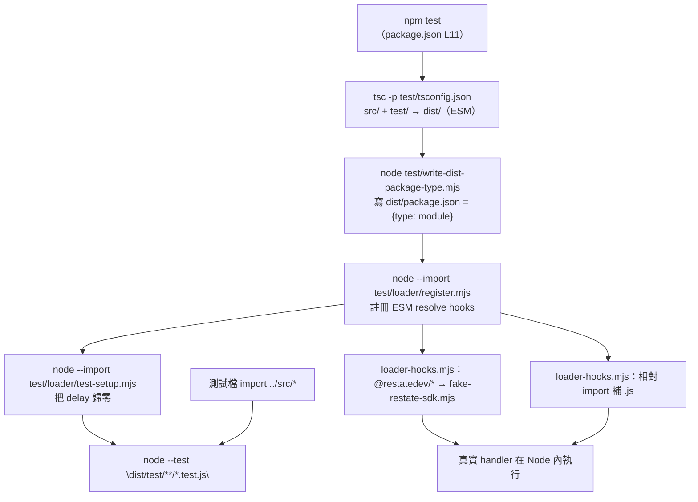

# Test Harness（測試執行基礎設施）

> **Relevant source files**
> * [package.json](../../package.json)
> * [test/loader/register.mjs](../../test/loader/register.mjs)
> * [test/loader/loader-hooks.mjs](../../test/loader/loader-hooks.mjs)
> * [test/loader/fake-restate-sdk.mjs](../../test/loader/fake-restate-sdk.mjs)
> * [test/loader/test-setup.mjs](../../test/loader/test-setup.mjs)
> * [test/helpers/mocks.ts](../../test/helpers/mocks.ts)
> * [test/helpers/integration.ts](../../test/helpers/integration.ts)

## Purpose and Scope

本文件說明 `npm test` 背後的測試 harness：它讓單元／整合測試在**一般 Node 程序**裡直接執行 `src/` 的真實 handler，**不需要** Restate server、不需要 workerd／wrangler 執行期、也不需要任何額外 npm 相依。

這層 harness 存在的兩個理由（皆為實測行為，非設計願景）：

1. **真實 SDK 在純 Node 下無法載入**。`src/` 各檔從 `@restatedev/restate-sdk-cloudflare-workers/fetch` 匯入，而該入口在模組載入期會 import `sdk_shared_core_wasm_bindings_bg.wasm` 的 default export（見 `node_modules/@restatedev/restate-sdk-cloudflare-workers/dist/endpoint/handlers/vm/sdk_shared_core_wasm_bindings.js`）。在 Node 22 直接 `import()` 該檔會得到 `SyntaxError: The requested module './sdk_shared_core_wasm_bindings_bg.wasm' does not provide an export named 'default'`；只有經 wrangler/workerd 的 bundler 路徑才可用。
2. **Restate 的執行期語意（持久化、重試、serde、虛擬物件排程）不在單元測試範圍內**。那些需要外部 Restate server，屬於 `test-all.sh`／`test-cloud.sh` 的 E2E 範疇。harness 用一個結構等價的鏡像 stub 取代 SDK，讓被測物件只剩「repo 自己的 handler 邏輯」。

對照既有文件：本文件講的是**在 `npm test` 裡跑的那一層**；`test-all.sh` 的 7 個 HTTP 情境見 [Testing-Strategy](Testing-Strategy.md) 與 [Local-Testing](Local-Testing.md)，K6 壓力測試見 [Load-Testing](Load-Testing.md)。

---

## 執行管線總覽



三個 `--import`／`--test` 階段的順序是**語意相關**的，不要隨便調換：`register.mjs` 必須先註冊 hooks，之後被 `test-setup.mjs` 與各測試檔載入的模組才會套用同一組 hooks（`test-setup.mjs` 匯入的 `dist/src/utils/delay.js` 才會和測試看到同一份模組實例——零延遲注入因此對所有測試生效）。

---

## 1. 編譯層：src 與 test 怎麼變成可執行的 ESM

| 元件 | 檔案 | 行為 |
| --- | --- | --- |
| 根 `tsconfig.json` | `tsconfig.json` | `noEmit: true`，供 `npx tsc -p tsconfig.json` 做 `src/` 型別檢查（wrangler 部署用的那一份），**不產出任何檔案**。 |
| 測試編譯設定 | `test/tsconfig.json` | `extends` 根設定，改用 `noEmit: false`、`noEmitOnError: true`、`module: esnext`、`moduleResolution: bundler`、`rootDir: ..`、`outDir: ../dist`，`include` 同時含 `../src/**/*.ts` 與 `./**/*.ts`。因此 `dist/` 裡會**同時**有 `dist/src/**` 與 `dist/test/**`，測試檔對 `../src/x` 的相對 import 在輸出後仍指向同一目錄結構。 |
| 產物標記為 ESM | `test/write-dist-package-type.mjs` | 在 `dist/` 寫一個只含 `{"type":"module"}` 的 `package.json`。根 `package.json` 沒有 `type` 欄位（也不該為了測試去動部署設定），沒有這個檔 Node 會把 `dist/**/*.js` 當成 CommonJS 而報錯。 |
| `node:test` 型別 | `test/types/node-test.d.ts` | repo 沒有 `@types/node` 相依，本檔以零相依方式**最小宣告**測試實際用到的 `node:test` 表面（`test`／`describe`／`it`／`it.skip`／`beforeEach`／`afterEach`、`t.assert.*`、`t.mock.timers`／`t.mock.method`）。用到未宣告的 API 時，要在這裡補宣告，而不是新增 `@types/node`。 |

`dist/` 與 `node_modules/` 都在 `.gitignore` 內，是純產物；改了任何 `.ts` 都需要重新 `npm run build:tests`（`npm test` 已自帶這一步）。

---

## 2. 攔截 module 載入：`register.mjs` 與 `loader-hooks.mjs`

`test/loader/register.mjs` 只做一件事——呼叫 `node:module` 的 `register()`，把 `loader-hooks.mjs` 註冊成 ESM resolve hook 的來源（`module.register()` 自 Node 20.6／18.19 起提供；本 repo 的 CI 用 Node 22）。

`test/loader/loader-hooks.mjs` 只實作 `resolve(specifier, context, nextResolve)`（**沒有 load hook**），內含兩條規則：

### 規則 A：把 `@restatedev/*` 導向鏡像 stub（`loader-hooks.mjs:14-16`）

```js
if (specifier.startsWith(SDK_PREFIX)) {
  return { url: FAKE_SDK, format: "module", shortCircuit: true };
}
```

* 比對的是**前綴** `@restatedev/`，不是完整套件名。因此 `@restatedev/restate-sdk-cloudflare-workers/fetch`（`src/` 與 `test/helpers/` 用的路徑）與任何其他 `@restatedev/...` 子路徑，在測試執行期都會被導向**同一份** `test/loader/fake-restate-sdk.mjs`。
* 這正是 `instanceof TerminalError` 在測試裡成立的條件：`src/checkout.ts` 拋出的 `restate.TerminalError` 與 `test/helpers/mocks.ts` 匯出比對的 `TerminalError`，被解析到同一個模組實例、同一個 class 物件。
* `shortCircuit: true` 讓 Node 不再繼續走預設解析，因此真實 SDK 的 wasm 依賴從頭到尾不會被載入。
* **型別仍然來自真實 SDK**：`tsc` 在編譯期讀的是 `node_modules` 裡的 `.d.ts`，loader 只換掉執行期的模組位址。所以 `mocks.ts` 可以一邊 `import { TerminalError }`（執行期＝stub）、一邊 `import type * as restate`（型別＝真實 SDK），型別檢查不會被 stub 削弱。

### 規則 B：對 tsc 輸出的無副檔名相對 import 補上 `.js`（`loader-hooks.mjs:17-31`）

`moduleResolution: bundler` 下，原始碼的 `import "./game"` 會被 tsc **原樣輸出**；Node 原生 ESM 卻要求完整檔名，會解析失敗。hook 的做法是先照常規 `nextResolve`，**只有在它拋錯時**才嘗試：若 specifier 以 `./` 或 `../` 開頭、且 `context.parentURL` 存在，就把 `specifier + ".js"` 對照 `parentURL` 解析，檔名真的存在（`existsSync`）才回傳，否則把原始錯誤照拋。

效果：不需要修改任何 `src/` 原始碼、也不需要引入打包器，就能跑 `dist/` 裡的 ESM。這個 fallback 只在解析失敗後觸發，不會遮蔽正常解析（例如真的存在同名目錄／附檔名檔案時照原樣走）。

---

## 3. `fake-restate-sdk.mjs`：提供的 API 與邊界

### 3.1 提供什麼

該檔匯出 `service`、`object`、`TerminalError`、`createEndpointHandler` 四個具名符號，外加一個內容相同的 `default` 物件。這四個正是 `src/` 唯一用到的 SDK 表面（`src/game.ts`、`src/checkout.ts`、`src/game_manager.ts` 用 `restate.service`／`restate.object`／`restate.TerminalError`，`src/index.ts` 用 `createEndpointHandler`）。

| 匯出 | 行為 | 實作位置 |
| --- | --- | --- |
| `service(def)` | `def.handlers` 缺失時 `throw new Error("service must be defined")`；否則回傳 `{ name, service: {...}, metadata, description, options }`，其中 `service` 是**逐 handler 建立的函式副本**（`handler.apply(this, args)`），並在副本上掛一個以 `Symbol.for("restate.handler")` 為 key 的標記 `{ kind: "service" }`。非函式的 handler 會 `throw new TypeError("Unexpected handler type <name>")`。 | `fake-restate-sdk.mjs:22-49` |
| `object(def)` | 同上，但缺 `handlers` 時訊息為 `"object options must be defined"`，回傳欄位是 `object`，標記 `kind` 為 `"exclusive"`。 | `fake-restate-sdk.mjs:22-36, 51-62` |
| `TerminalError` | `class TerminalError extends Error`，`name = "TerminalError"`；`options.errorCode` 為**數字**時才掛上 `this.errorCode`。 | `fake-restate-sdk.mjs:64-72` |
| `createEndpointHandler()` | **忽略傳入的 options**（含 `services` 清單），回傳 `async handler(request)`：把 `{ url, method }` 推入 `globalThis.__restateEndpointCalls`，然後回 `new Response("FAKE-RESTATE-ENDPOINT", { status: 599 })`。 | `fake-restate-sdk.mjs:74-80` |

`service()`／`object()` 的欄位形狀（`def.service`／`def.object` 是「handler 名稱 → 可用 `(ctx, ...args)` 呼叫的函式」）就是 `test/helpers/mocks.ts` 的 `handlersOf()` 所依賴的契約——它是整層 harness 能把「定義」還原成「可直接的 handler」的基礎。

### 3.2 不模擬什麼（邊界）

* **不碰 Restate 協定與執行期**：沒有 HTTP／handshake 協定、沒有 journaling／持久化／重播、沒有重試策略、沒有 serde／input-output 序列化、沒有虛擬物件的 exclusive 排程與狀態儲存、沒有與 Restate server 的任何互動。`ctx.run` 的「持久化後重放」語意在測試中由 helpers 以「立即執行閉包」代替（見 §4）。
* **`createEndpointHandler` 是記錄用替身，不是端點**：它不做服務註冊、不做路由、不做參數解碼。`src/index.ts` 把非 `/api/mock-payment` 的要求一律交給它，所以 `test/index.test.ts` 斷言的是 **`index.ts` 自己的路由行為**（該檔以 `response.status === 599` 與 `globalThis.__restateEndpointCalls` 證明「該請求確實交給 restate handler 處理」，見 `test/index.test.ts:37`），不是 Restate 內部的行為。
* **鏡像的是「結構語意」而非同一份實作**。以本 repo 相依範圍內實際裝起來的版本（`^1.17.0`）為例，真實 SDK 的 `service()`／`object()` 除 `name`／`service|object`／`metadata`／`description`／`options` 外，還會附加 `_kind` 與 `_handlers`（handler descriptor），並用模組內私有的 `Symbol("Handler")` 掛 `HandlerWrapper` 實例；stub 則沒有 `_kind`／`_handlers`，用的是 `Symbol.for("restate.handler")` 掛 `{ kind }`。真實 `TerminalError` 繼承 `RestateError`，帶 `code`（未給 `errorCode` 時為 500）與 `metadata`；stub 只有 `message`／`name`／可選 `errorCode`。既有測試只讀 `def.service`／`def.object`、`instanceof TerminalError` 與 `message`，因此這些差異不影響任何斷言。
* **stub 的鏡像註解對照的是 v1.9.1 的 `dist/types/rpc.js`**（見該檔檔頭註解），而 `package.json` 的相依範圍是 `^1.17.0`（本 repo 實裝 1.17.0，其 `/fetch` 入口共匯出 23 個符號，stub 只鏡像 `src/` 用到的 4 個）。日後 `src/` 用到 stub 沒鏡像的匯出（例如 `workflow`、`serde`、`rpc`、`Opts`、`RestatePromise`）時，失敗是響亮的：具名匯入（如 `src/index.ts` 的 `import { createEndpointHandler }`）會在 ESM 連結期報 `The requested module ... does not provide an export named ...`；`import * as restate` 的命名空間寫法不在載入期報錯，而是等到真的存取那個成員時才以 `TypeError: restate.<name> is not a function` 失敗。兩種情形都該在 `fake-restate-sdk.mjs` 補鏡像（屬於測試基礎設施，不是 `src/`），並同步更新本節。

---

## 4. `test/helpers/`：兩層 harness，選錯層會測不到東西

### 4.1 `mocks.ts`——單 handler 的記錄型替身（預設起點）

| 匯出 | 用途 |
| --- | --- |
| `createMockState(initial?)` | 建立 `MockState`：`data`（KV 儲存，可用初始值注入）、`sets`、`clears`、`runs`、`objectCalls`、`sendCalls`。 |
| `createMockContext(mock, { overrides?, sendOverrides? })` | 建立足以驅動 `src/` handler 的 mock Context（回傳型別為真實 SDK 的 `restate.Context`）。 |
| `handlersOf<T>(def, "service" \| "object")` | 從 `service()`／`object()` 的產物取出原始 handler 集合；欄位缺失時拋 `definition is missing "<field>" handlers (SDK shape changed?)`，把 SDK 形狀漂移變成響亮失敗。 |
| `RecordedCall`／`ClientOverrides` | 呼叫記錄的形狀（`{ service, key, handler, args }`）與注入型別。 |
| `TerminalError`（re-export） | 讓測試與 `src/` 比對同一個 class（經 loader 導向同一份 stub）。 |

Context 各方法的既有行為（`mocks.ts:65-94`）：

* `get(k)` 讀 `mock.data`，**未設定回傳 `null`**（不是 `undefined`）。
* `set(k, v)` 寫入並追進 `mock.sets`；`clear(k)` 刪除並追進 `mock.clears`。
* `run(label, fn)` 把 `label` 追進 `mock.runs`，**立即 `await fn()`**——即「持久化閉包即時執行」的逼近，不做重放。
* `objectClient(def, key)` → 記錄到 `mock.objectCalls`（同步等待型）；`objectSendClient(def, key)`／`serviceSendClient(def)` → 記錄到 `mock.sendCalls`（fire-and-forget 型；後者的 `key` 記為空字串）。
* 三者都是 Proxy：任何 handler 名稱都接受。未注入 override 時**一律回傳 `undefined`**，只留下記錄。`overrides[service][handler]`／`sendOverrides[...]` 可以指定某個跨物件呼叫的回傳值或拋錯（例如讓 `reserve` 拋 `TerminalError("Ticket already sold")`，見 `test/checkout.test.ts:136`）。

適用時機：驗證**單一 handler** 的分支、回傳值、拋錯型別、呼叫順序與補償路徑。限制要記住：因為 client 只記錄、不執行真實 handler，**跨物件的狀態不會真的流動**（`Ticket.reserve` 被呼叫後，座位的 `map` 不會變）。需要看見「A 的真實 handler 改到 B 的狀態」時，這層測不到。

### 4.2 `integration.ts`——真實 handler 互接的「世界」

`createIntegration(initialNow?)` 回傳 `IntegrationWorld`：`world`、`ticket(key)`、`seatMap`、`checkout`、`manager`、`stateOf(service, key)`、`deliver(n)`、`drain()`。它把 `Ticket`／`SeatMap`／`GameManager`／`Checkout` 的**真實 handler** 接線到共享狀態（依 `${service}:${key}` 分槽，`slotOf()`），跨物件呼叫會路由到真實 handler 而非回 `undefined`。四項能力（對應檔頭 ①–④，自我驗證見 `test/harness_fidelity.test.ts`）：

1. **per-(service,key) 非同步互斥**（`enqueueOnSlot`）：同一槽的 handler 依 FIFO 序列化，逼近 Virtual Object 的 `exclusive` 語意；等待鏈只追蹤完成、成敗皆吞，所以 handler 拋錯不會卡死後面的排隊者。
2. **fire-and-forget 延遲投遞**：`objectSendClient`／`serviceSendClient` 的呼叫只入 `world.pendingSends`（FIFO）並立即回 `undefined`，真正執行延後到 `deliver(n)`／`drain()`；投遞時拋出的異常被隔離到 `world.deliveryErrors`。因此「投遞視窗」本身可被斷言。`deliver()` 有 `MAX_DELIVERIES = 10_000` 的保險絲，病理自排會拋錯而非無限投遞。
3. **`ctx.run` 插隊控制點**：`world.hooks.before`／`after` 在每個 run 邊界以 `(label, service, key)` 依序觸發且被 `await`，讓測試能在「付款完成、`confirm` 之前」這種精確時點注入交錯。未設 hook 時行為與 §4.1 同。
4. **呼叫軌跡**：`world.calls` 以 `mocks.ts` 的 `RecordedCall` 形狀記錄每次**真實 handler 執行**（含 service 入口、跨物件 client、延遲投遞）；尚待投遞的 send 不在軌跡中，投遞時才進。

另有受控時鐘：`world.now()`（`createIntegration(initialNow)` 固定它），且 `run("now")` 這個 label 會**直接回傳 `world.now()`**（`integration.ts:246`）而不是執行閉包——TTL 逾期這類「時間語意」情境靠它注入，與 §5 的零延遲注入無關。

適用時機：跨物件、跨 handler 的一致性／競態情境（`test/integration_scenarios.test.ts` 的 S1–S6）。誠實記錄的限制（同檔 24-29 行）：它模擬的是「應用層狀態機＋單執行緒序列化交錯」，**不模擬**持久化、重播、多機器真並行；且若同一 handler 執行中（透過 hook 或嵌套 client）再呼叫自己所在槽位，互斥會排队在自身之後而**死鎖**——`src/` 現況無此形狀，但新增測試時要避開（跨槽互等 A→B→A 同理）。

### 4.3 該用哪一層

| 你要斷言的東西 | 用 |
| --- | --- |
| 單 handler 的回傳值／拋錯／寫了哪些 KV key／發了哪些跨物件呼叫（順序與引數） | `helpers/mocks.ts` |
| 「讓某個跨物件呼叫失敗或回特定值」以驅動補償路徑 | `mocks.ts` 的 `overrides`／`sendOverrides` |
| 跨 handler 的共享狀態、雙重成交、TTL 逾期、auto-reset 鏈路 | `helpers/integration.ts` |
| 需要精確控制交錯時點（「付完款但尚未 confirm」） | `integration.ts` 的 `hooks.before/after` |
| 需要「message 尚未投遞」這個中間狀態 | `integration.ts` 的 `pendingSends` + `deliver(n)` |
| HTTP 層路由（哪些要求交給 restate handler） | `src/index.ts` 的 default export + `test/index.test.ts` 的 `__restateEndpointCalls` |

---

## 5. `test-setup.mjs`：全域零延遲注入

`src/utils/payment_new.ts`／`src/utils/email.ts`／`src/index.ts` 用 `delay()` 模擬外部 I/O 延遲（500ms／200ms）。`test/loader/test-setup.mjs` 在測試啟動時對 `dist/src/utils/delay.js` 呼叫 `setDelayImpl(() => Promise.resolve())`，把延遲歸零，使套件 wall time 反映真正的邏輯成本（本次實測：64 個測試／26 個 suite，約 0.5 秒跑完）。

這不削弱任何斷言：延遲長度從未被任何測試斷言，被驗證的是回傳值／拋錯型別／狀態轉移／呼叫順序。兩點要注意：

* 需要**預設延遲實作**的測試（`test/delay.test.ts`）要先顯式 `resetDelayImpl()`，並在 `afterEach` 還原零延遲注入——`delay.ts` 的 `impl` 是模組單例，不還原就會洩漏給後續測試。
* 因為這是**程序級**全域注入，它套用於 `npm test`、`test:race`、`test:coverage` 全部指令（它們的 `--import` 清單相同）。

---

## 6. 新增一個測試的步驟

1. **建檔**：在 `test/` 下新增 `<name>.test.ts`。檔名要以 `.test.ts` 結尾——`npm test` 跑的是 glob `dist/test/**/*.test.js`，`test/tsconfig.json` 的 `include: ["../src/**/*.ts", "./**/*.ts"]` 會自動把它編進 `dist/test/`。**不需要改 `package.json` 或任何設定。**
2. **寫骨架**：從 `node:test` 匯入 `describe`／`it`（必要時 `beforeEach`／`afterEach`），斷言一律用測試回呼引數提供的 `t.assert.*`。用到 `node-test.d.ts` 未宣告的 API 時，在該檔補最小宣告（不要新增 `@types/node`）。
3. **取被測 handler**：
   ```ts
   import { checkoutWorkflow } from "../src/checkout";
   import { createMockContext, createMockState, handlersOf } from "./helpers/mocks";

   const handlers = () =>
     handlersOf<{ process: (ctx: any, req: { ticketId: string; userId: string }) => Promise<string> }>(
       checkoutWorkflow,
       "service"
     );
   ```
   對 `src/` 的 import 用**不附副檔名**的相對路徑即可（§2 規則 B 會在執行期補 `.js`）；`node:` 開頭的核心模組照原生寫。
4. **選 harness**：照 §4.3 的表選 `mocks.ts`（記錄型）或 `integration.ts`（真實互接）。
5. **執行**：
   * `npm test`——先 `build:tests`（tsc＋`dist/package.json`）再跑全部 `dist/test/**/*.test.js`。
   * `npm run test:race`——同樣的 loader/setup／編譯前置，只跑 `race_counterexample.test.js`（Quint 反例的機械化重現套件）。
   * `npm run test:coverage`——加 `--experimental-test-coverage --test-coverage-exclude="dist/test/**" --test-reporter=spec`，覆蓋率只算 `dist/src/**`。
   * 只想跑單一檔：先 `npm run build:tests`，再
     `node --import ./test/loader/register.mjs --import ./test/loader/test-setup.mjs --test "dist/test/<name>.test.js"`。
6. **只要型別檢查時**：`npx tsc -p test/tsconfig.json --noEmit`（不產 dist）。注意 `build:tests` 開了 `noEmitOnError`，任何型別錯誤都會讓整條 `npm test` 在編譯階段就紅。
7. **需要 Restate server 的情境不屬於這一層**：`./test-all.sh`（本地 Docker）／`./test-cloud.sh`（Restate Cloud）才是端到端；`npm test` 刻意不含任何外部服務相依，CI 也據此把 `npm test` 當 PR 閘門。
8. **揭露既有缺陷時**：依工廠慣例以 `it.skip("…")` 交付（斷言完整保留、紅燈原因與建議寫在測試上方註解與 Issue），不要在測試裡放寬斷言。這個慣例的說明見 `test/integration_scenarios.test.ts:15` 與 `test/game.test.ts:45` 的案例註解；本文件撰寫時套件內**沒有**仍處於 skip 的測試（`npm test` 回報 `# skipped 0`）。

### 常見失敗與原因

| 症狀 | 原因／處置 |
| --- | --- |
| `The requested module '@restatedev/...' does not provide an export named 'X'` | `src/` 或 helpers 用到 `X`，但 `fake-restate-sdk.mjs` 沒鏡像它 → 在 stub 補鏡像（並更新本文件 §3）。 |
| `Cannot find module '/…/dist/src/game'`（或 `ERR_MODULE_NOT_FOUND`） | 相對 import 補 `.js` 的 fallback 沒命中：檢查該檔是否已 `npm run build:tests` 產出，以及路徑是否真的對應 `dist/` 下的檔名。 |
| `SyntaxError: The requested module './…_bg.wasm' does not provide an export named 'default'` | 測試繞過了 loader（例如沒帶 `--import ./test/loader/register.mjs` 就直跑 `node --test dist/test/**`），真實 SDK 因而被載入 → 用 §6 第 5 步的完整指令。 |
| `Unexpected handler type <name>` | `service()`／`object()` 的 `handlers` 裡有非函式值（鏡像保留了真實 SDK 的這個檢查）。 |
| `definition is missing "object" handlers (SDK shape changed?)` | `handlersOf()` 的欄位契約 破了：定義不是經 stub／SDK 的 `service()`／`object()` 建立，或 SDK 換了回傳形狀。 |
| 整合測試永不結束（hang） | 踩到 §4.2 的死鎖條件：某 handler 在自己槽位上又排隊了一次。改用 `deliver()`／`hooks` 把交錯移到別的槽。 |
| 測試跑得很慢，時間都花在等待 | 零延遲注入沒生效（`test-setup.mjs` 未被 `--import`，或有人在測試內呼叫了 `resetDelayImpl()` 後忘記還原）。 |

---

## 7. 速查表

| 項目 | 值 |
| --- | --- |
| 前置：安裝相依 | `npm ci --legacy-peer-deps`（wrangler@4 的 optional peer 要求 `@cloudflare/workers-types@^5`，本 repo 固定在 `^4`） |
| 執行期 | Node 22（CI 的 `setup-node` 錨在 22；`node:test` 型別宣告對應 Node 22） |
| 編譯測試產物 | `npm run build:tests` |
| 全量測試 | `npm test` |
| 只跑競態反例套件 | `npm run test:race` |
| 覆蓋率（非阻擋） | `npm run test:coverage` |
| 型別檢查（src／tests） | `npx tsc -p tsconfig.json`／`npx tsc -p test/tsconfig.json --noEmit` |
| 被測程式碼進入點 | `dist/test/**/*.test.js`（由 `test/*.test.ts` 編出） |
| SDK 攔截開關 | `--import ./test/loader/register.mjs` |
| 延遲歸零開關 | `--import ./test/loader/test-setup.mjs` |
| 目前套件規模（本文件撰寫時實測） | 11 個 `test/*.test.ts`、26 個 suite、64 個測試全綠、0 skip |

**Related Pages**：[Testing-Strategy](Testing-Strategy.md)（策略總覽與 E2E 情境）、[Local-Testing](Local-Testing.md)、[Load-Testing](Load-Testing.md)、[TypeScript-Configuration](TypeScript-Configuration.md)、[Dependencies](Dependencies.md)。

**Sources**：`package.json`（scripts）、`test/loader/register.mjs:1-6`、`test/loader/loader-hooks.mjs:1-32`、`test/loader/fake-restate-sdk.mjs:1-87`、`test/loader/test-setup.mjs:1-15`、`test/write-dist-package-type.mjs:1-7`、`test/tsconfig.json`、`test/types/node-test.d.ts`、`test/helpers/mocks.ts:1-107`、`test/helpers/integration.ts:1-359`、`src/utils/delay.ts:13-31`、`src/index.ts:1-52`、`.github/workflows/test.yml`。
