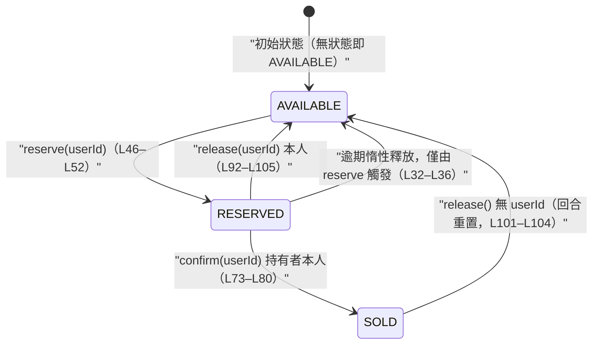
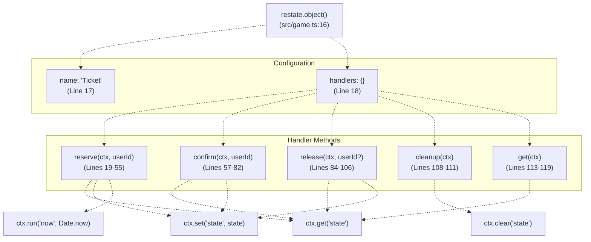
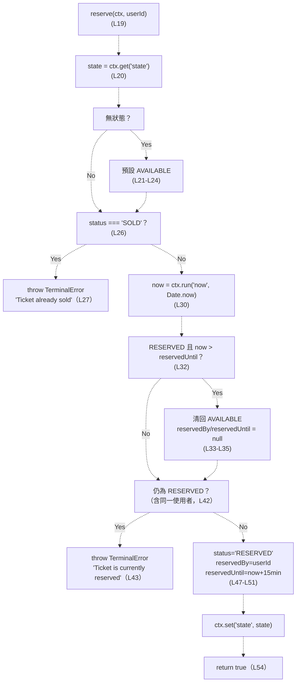
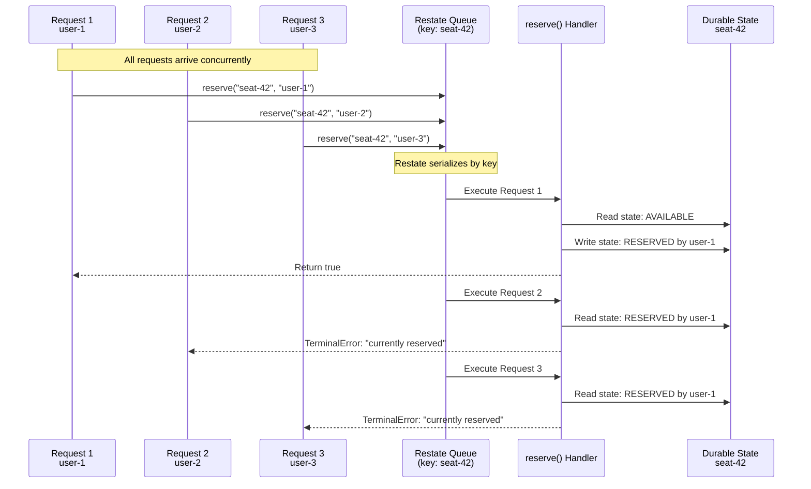
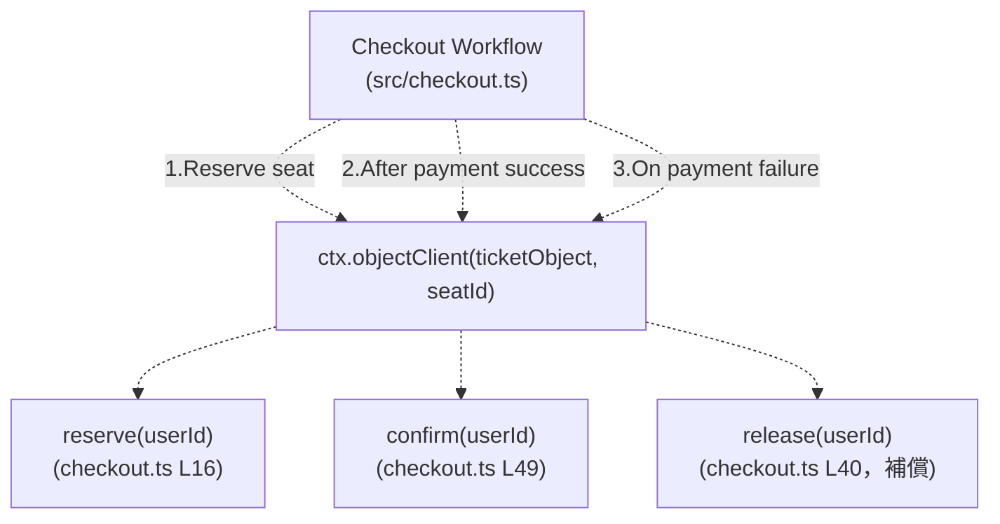

# Ticket Virtual Object

> **Relevant source files**
> * [README.md](https://github.com/philipz/restate-cloudflare-workers-poc/blob/513fd0f5/README.md)
> * [src/game.ts](https://github.com/agent-playground/restate-cloudflare-workers-poc/blob/abf3d0d/src/game.ts)
> * [src/game_manager.ts](https://github.com/agent-playground/restate-cloudflare-workers-poc/blob/abf3d0d/src/game_manager.ts)
> * [test/game.test.ts](https://github.com/agent-playground/restate-cloudflare-workers-poc/blob/abf3d0d/test/game.test.ts)
> * [test/game_manager_reset_resale.test.ts](https://github.com/agent-playground/restate-cloudflare-workers-poc/blob/abf3d0d/test/game_manager_reset_resale.test.ts)
> * [test/seatmap_conditional_write.test.ts](https://github.com/agent-playground/restate-cloudflare-workers-poc/blob/abf3d0d/test/seatmap_conditional_write.test.ts)

## Purpose and Scope

本文詳細說明 `Ticket` 虛擬物件——票券系統中單一座位的狀態管理器。Ticket 實作一個三狀態（`AVAILABLE`、`RESERVED`、`SOLD`）的狀態機，提供狀態轉換方法，並由 Restate 的虛擬物件序列化機制自動防止競態條件。

關於席位聚合視圖（SeatMap）與其條件寫入、自動重置（回合重置）機制，請見 [SeatMap Virtual Object](/philipz/restate-cloudflare-workers-poc/2.2-seatmap-virtual-object)。關於編排 Ticket 操作的完整訂位流程，請見 [Checkout Workflow](/philipz/restate-cloudflare-workers-poc/2.3-checkout-workflow)。關於虛擬物件與序列化的通用概念，請見 [Virtual Objects & Serialization](/philipz/restate-cloudflare-workers-poc/8.1-virtual-objects-and-serialization)。

**Sources**: [src/game.ts L8-L123](https://github.com/agent-playground/restate-cloudflare-workers-poc/blob/abf3d0d/src/game.ts#L8-L123)

---

## State Structure

Ticket 虛擬物件以強型別狀態介面為每個座位維護可重播（durable）狀態。每個 Ticket 實例以 `seatId` 為 key（例如 `"seat-1"`、`"seat-42"`），Restate 保證同一座位的所有操作自動序列化。

### TicketState Interface

| Field | Type | Description |
| --- | --- | --- |
| `status` | `TicketStatus` | 目前座位狀態：`"AVAILABLE"`、`"RESERVED"` 或 `"SOLD"` |
| `reservedBy` | `string \| null` | 保留此票券的使用者 ID；未保留時為 `null` |
| `reservedUntil` | `number \| null` | 保留逾期的 Unix 時間戳（毫秒）；未保留時為 `null` |

`TicketStatus` 型別定義為三個字面字串的聯集（[L8](https://github.com/agent-playground/restate-cloudflare-workers-poc/blob/abf3d0d/src/game.ts#L8-L8)），為狀態轉換提供編譯期型別安全。

**Sources**: [src/game.ts L8-L14](https://github.com/agent-playground/restate-cloudflare-workers-poc/blob/abf3d0d/src/game.ts#L8-L14)

---

## State Machine

Ticket 物件實作一個三狀態的有限狀態機。下圖呈現所有合法的狀態轉換與觸發它的方法（括號內為 `src/game.ts` 目前版本的程式行號）：



### State Transition Rules

1. **AVAILABLE → RESERVED**：由 `reserve(userId)` 觸發（[L46-L52](https://github.com/agent-playground/restate-cloudflare-workers-poc/blob/abf3d0d/src/game.ts#L46-L52)）。設定 `reservedBy` 為呼叫者，並以可重播時鐘（`ctx.run("now", ...)`，L30）計算 `reservedUntil = now + 15 分鐘`（L50）。
2. **RESERVED → SOLD**：由 `confirm(userId)` 觸發（[L77-L80](https://github.com/agent-playground/restate-cloudflare-workers-poc/blob/abf3d0d/src/game.ts#L77-L80)）。僅當 `status === "RESERVED"` 且 `reservedBy === userId` 時放行（守衛見 L73-L75）；寫入後 `reservedUntil` 清空為 `null`（L79）。
3. **RESERVED → AVAILABLE**：由 `release(userId)` 觸發（[L101-L104](https://github.com/agent-playground/restate-cloudflare-workers-poc/blob/abf3d0d/src/game.ts#L101-L104)）。帶 `userId` 時僅允許保留者本人釋放（守衛 L92-L98，不符則回 `false`、不寫入）。
4. **RESERVED（已逾期）→ AVAILABLE**：**惰性**發生，且**只**在 `reserve` 進入時檢查（[L32-L36](https://github.com/agent-playground/restate-cloudflare-workers-poc/blob/abf3d0d/src/game.ts#L32-L36)）：若 `now > reservedUntil`，舊保留被釋放後由新呼叫者直接接手。詳見下方「TTL 惰性逾期」。
5. **SOLD → AVAILABLE**：正常業務流程中 SOLD 是終端狀態；唯一的逆向路徑是**不帶 `userId`** 的 `release()`——守衛區塊（L92-L98）整個跳過，SOLD 票也被清回 AVAILABLE。這是「回合重置」的機制（產品裁定 2026-10-19，見 [SeatMap Virtual Object](/philipz/restate-cloudflare-workers-poc/2.2-seatmap-virtual-object) 的回合重置章節；呼叫端為 `src/game_manager.ts` [L15-L17](https://github.com/agent-playground/restate-cloudflare-workers-poc/blob/abf3d0d/src/game_manager.ts#L15-L17)）。
6. **SOLD → SOLD（冪等重試）**：同一持有者重複 `confirm(userId)` 直接回 `true`、不再寫入（[L64-L68](https://github.com/agent-playground/restate-cloudflare-workers-poc/blob/abf3d0d/src/game.ts#L64-L68)）；他人 `confirm` 則拋出 `TerminalError`（L69）。

### TTL 惰性逾期（重要語意）

15 分鐘保留期**沒有計時器、也沒有背景任務**，逾期判定是**惰性**的：

* **只有 `reserve` 檢查逾期**：每次 `reserve` 呼叫以重播安全的 `now`（L30）比對 `reservedUntil`，逾期即先在記憶體中把狀態清回 AVAILABLE（[L31-L36](https://github.com/agent-playground/restate-cloudflare-workers-poc/blob/abf3d0d/src/game.ts#L31-L36)），讓新呼叫者接手。
* **`confirm` 不檢查 `reservedUntil`**：`confirm`（[L57-L82](https://github.com/agent-playground/restate-cloudflare-workers-poc/blob/abf3d0d/src/game.ts#L57-L82)）從不取時鐘，守衛只比對 `status === "RESERVED" && reservedBy === userId`（L73-L75）。
* **可觀察後果**：保留逾期後，若**沒有人**對該席發起新的 `reserve`（無人触发惰性回收），**原持有者即使在逾期之後 `confirm` 仍會成功**，把逾期保留轉為 SOLD。規格測試 `test/game.test.ts` 的 `"RESERVED → SOLD，清空 reservedUntil，維持 reservedBy"`（以 `reservedUntil: 999` 的遠過去值驗證）與「他人 RESERVED 但已逾期（TTL 過期）：允許新使用者預約並覆寫持有者」兩條把這個語意釘住。

**Sources**: [src/game.ts L19-L82](https://github.com/agent-playground/restate-cloudflare-workers-poc/blob/abf3d0d/src/game.ts#L19-L82), [test/game.test.ts](https://github.com/agent-playground/restate-cloudflare-workers-poc/blob/abf3d0d/test/game.test.ts)

---

## Virtual Object Definition

Ticket 虛擬物件以 Restate SDK 的 `object()` 函式建立（[L16](https://github.com/agent-playground/restate-cloudflare-workers-poc/blob/abf3d0d/src/game.ts#L16-L16)），依 object key 自動序列化併發請求。



**Key Characteristics**:

* **Object Name**: `"Ticket"`——經 Restate API 呼叫物件時使用的服務識別名（L17）。
* **Object Context**: 所有 handlers 的第一個參數是 `restate.ObjectContext`，提供狀態存取與可重播執行能力。
* **State Persistence**: 狀態經 `ctx.get<TicketState>("state")` 讀取、`ctx.set("state", state)` 持久化。
* **Default State**: 若尚無狀態，各 handler 以 `{ status: "AVAILABLE", reservedBy: null, reservedUntil: null }` 初始化（例如 [L20-L24](https://github.com/agent-playground/restate-cloudflare-workers-poc/blob/abf3d0d/src/game.ts#L20-L24)）。

**Sources**: [src/game.ts L16-L121](https://github.com/agent-playground/restate-cloudflare-workers-poc/blob/abf3d0d/src/game.ts#L16-L121)

---

## Handler Methods

### reserve(ctx, userId)

嘗試為指定使用者保留票券，是核心併發控制所在。

**Parameters**:

* `ctx`: `restate.ObjectContext`
* `userId`: `string`——發起預約的使用者識別碼

**Behavior**:



**Key Implementation Details**:

* **已 RESERVED 一律拒絕（含同一使用者）**：Issue #21 刻意變更語意——同 user 重複 `reserve` **不再冪等回 `true`**，一律拋 `TerminalError("Ticket is currently reserved")`（[L38-L44](https://github.com/agent-playground/restate-cloudflare-workers-poc/blob/abf3d0d/src/game.ts#L38-L44)），以杜絕同一使用者併發結帳同一座位造成的雙重扣款。重播安全不受影響：同 invocation 的重試由 Restate journal 重放，不會重呼 handler。
* **逾期惰性回收**：逾期的 RESERVED 在上述守衛**之前**被清回 AVAILABLE（L31-L36），因此「逾期後被他人接手」是合法路徑；仍走到 L42 的 RESERVED 必屬有效保留。
* **Durable Timestamp**：`ctx.run("now", () => Date.now())`（[L30](https://github.com/agent-playground/restate-cloudflare-workers-poc/blob/abf3d0d/src/game.ts#L30-L30)）讓時間在故障重播後保持一致。
* **Reservation Window**：`reservedUntil = now + 15 * 60 * 1000`（900,000 毫秒，L50）。
* **Terminal Errors**：業務失敗以 `restate.TerminalError` Signal 重試不會成功（L27、L43）。

**Sources**: [src/game.ts L19-L55](https://github.com/agent-playground/restate-cloudflare-workers-poc/blob/abf3d0d/src/game.ts#L19-L55)

---

### confirm(ctx, userId)

將已保留的票券轉為 `SOLD`。由 Checkout workflow 在收款成功後帶買家身分呼叫（[src/checkout.ts L49](https://github.com/agent-playground/restate-cloudflare-workers-poc/blob/abf3d0d/src/checkout.ts#L49-L49)）。

**Parameters**:

* `ctx`: `restate.ObjectContext`
* `userId`: `string`——呼叫者身分，必須與 `reservedBy` 一致才可成交

**Behavior**（實作見 [L57-L82](https://github.com/agent-playground/restate-cloudflare-workers-poc/blob/abf3d0d/src/game.ts#L57-L82)）:

| 目前狀態 | 呼叫者 | 結果 | 行號 |
| --- | --- | --- | --- |
| `RESERVED` | `reservedBy` 本人 | 轉為 `SOLD`、`reservedUntil = null`、回 `true` | L73-L81 |
| `RESERVED` | 他人 | `TerminalError("Ticket is not reserved by user …")` | L73-L75 |
| `AVAILABLE` | 任何人 | 同上 `TerminalError`——不再容忍未經預訂直接確認 | L73-L75 |
| `SOLD` | 同一持有者 | 冪等重試：直接回 `true`，**不再寫入** | L64-L68 |
| `SOLD` | 他人 | `TerminalError("Ticket already sold to another user: …")` | L69 |

**要點**：

1. **持有者守衛**（L72-L75）：必須 `status === "RESERVED"` 且 `reservedBy === userId`；髒狀態值（非三合法字面值）同樣被守衛擋下並拋 `TerminalError`。
2. **不檢查 `reservedUntil`**：`confirm` 全程不呼叫 `ctx.run("now", …)`、不比較逾期（見上方「TTL 惰性逾期」）。逾期但無人接手時，本人 `confirm` 仍成功轉為 SOLD。
3. 成交寫入（L77-L80）：`status = "SOLD"`、`reservedBy = userId`、`reservedUntil = null`，經 `ctx.set("state", state)` 持久化後回 `true`（L81）。

**Sources**: [src/game.ts L57-L82](https://github.com/agent-playground/restate-cloudflare-workers-poc/blob/abf3d0d/src/game.ts#L57-L82), [test/game.test.ts](https://github.com/agent-playground/restate-cloudflare-workers-poc/blob/abf3d0d/test/game.test.ts)

---

### release(ctx, userId?)

把票券清回 `AVAILABLE`。**帶不帶 `userId` 是兩條不同的路徑**（實作見 [L84-L106](https://github.com/agent-playground/restate-cloudflare-workers-poc/blob/abf3d0d/src/game.ts#L84-L106)）：

* **帶 `userId`（saga 補償路徑）**——Checkout 收款失敗時呼叫（src/checkout.ts L40）：
  * 已 `SOLD` → 回 `false`、不寫入（[L93-L95](https://github.com/agent-playground/restate-cloudflare-workers-poc/blob/abf3d0d/src/game.ts#L93-L95)）；
  * `reservedBy` 存在且非本人 → 回 `false`、不寫入（L96-L98）；
  * 其餘情況（本人保留、或已 AVAILABLE）→ 清空回預設狀態並回 `true`。
  呼叫端據回傳值決定是否回寫 SeatMap 視圖（Issue #22；Issue #82 之後由 SeatMap 端條件寫入再補一層，見 [SeatMap Virtual Object](/philipz/restate-cloudflare-workers-poc/2.2-seatmap-virtual-object)）。
* **不帶 `userId`（系統路徑）**——回合重置由 `GameManager.reset` 對 seat-1..50 逐張发出（src/game_manager.ts L15-L17）：守衛區塊（L92-L98）整個跳過，**無條件**把票券（**含 SOLD**）清回 `AVAILABLE`、回 `true`（L101-L105）。

**Sources**: [src/game.ts L84-L106](https://github.com/agent-playground/restate-cloudflare-workers-poc/blob/abf3d0d/src/game.ts#L84-L106), [src/game_manager.ts L13-L17](https://github.com/agent-playground/restate-cloudflare-workers-poc/blob/abf3d0d/src/game_manager.ts#L13-L17)

---

### cleanup(ctx)

以 `ctx.clear("state")` **移除**狀態鍵（[L108-L111](https://github.com/agent-playground/restate-cloudflare-workers-poc/blob/abf3d0d/src/game.ts#L108-L111)），回 `true`。與 `release` 的差異：`release` 把狀態**重設為 AVAILABLE 寫回**，`cleanup` 則不留任何狀態——之後的讀取落回各 handler 的預設初始化。目前 `src/` 內沒有生產呼叫端；單元測試 `test/game.test.ts` 的 `cleanup：清除 state 鍵` 驗證其行為。

**Sources**: [src/game.ts L108-L111](https://github.com/agent-playground/restate-cloudflare-workers-poc/blob/abf3d0d/src/game.ts#L108-L111)

---

### get(ctx)

不加修改地讀取目前狀態，純查詢操作。

**Parameters**:

* `ctx`: `restate.ObjectContext`

**Return Value**: `TicketState`——目前狀態；尚無狀態時回傳預設（`AVAILABLE`），且**不寫回**。

**Use Cases**:

* 前端查詢座位可用性
* `SeatMap.set` 的條件寫入在同一次 handler 執行內讀取本物件真值（src/game.ts L142-L147，Issue #82）
* 測試與除錯

**Sources**: [src/game.ts L113-L119](https://github.com/agent-playground/restate-cloudflare-workers-poc/blob/abf3d0d/src/game.ts#L113-L119), [src/game.ts L142-L147](https://github.com/agent-playground/restate-cloudflare-workers-poc/blob/abf3d0d/src/game.ts#L142-L147)

---

## Concurrency Control and Serialization

Ticket 虛擬物件依賴 Restate 的自動序列化防止競態。多個併發請求打向同一座位時，Restate 依 object key 排隊、逐個執行 handlers。

### Serialization Mechanism



**Key Properties**:

1. **No Explicit Locks**：開發者不需管理鎖、互斥器或交易。
2. **Automatic Ordering**：Restate 以確定性順序排隊請求。
3. **State Isolation**：每個 `seatId` 狀態彼此隔離；`seat-1` 與 `seat-2` 的請求可平行執行。
4. **Race Condition Prevention**：只有隊列中第一個請求看到 `AVAILABLE`；其後請求（**含同一使用者**，Issue #21）看到 `RESERVED` 並收到 `TerminalError`。
5. **檢查與寫入同-handler**：`reserve` 的逾期檢查、守衛與寫入都在同一次 handler 執行內完成（L20-L52），不會出現「檢查後、寫入前被插隊」的窗口。

**Sources**: [src/game.ts L19-L55](https://github.com/agent-playground/restate-cloudflare-workers-poc/blob/abf3d0d/src/game.ts#L19-L55)

---

## Error Handling

Ticket 物件以 Restate 的 `TerminalError` 表示「重試不會成功」的業務失敗，與基礎設施的瞬時錯誤區分。

### Terminal Error Scenarios

| Scenario | Error Message | Trigger Condition | 行號 |
| --- | --- | --- | --- |
| Already Sold | `"Ticket already sold"` | 對 `SOLD` 票呼叫 `reserve()` | L26-L28 |
| Already Reserved | `"Ticket is currently reserved"` | 對**有效**（未逾期）`RESERVED` 票呼叫 `reserve()`——**含同一使用者**（Issue #21） | L42-L44 |
| Not Reserved by User | `"Ticket is not reserved by user ${userId} (status: …, reservedBy: …)"` | `confirm()` 時非 `RESERVED` 或呼叫者非持有者 | L73-L75 |
| Sold to Another User | `"Ticket already sold to another user: ${reservedBy}"` | 對他人持有的 `SOLD` 票呼叫 `confirm()` | L64-L70 |

另有**不拋錯**的回傳路徑：`release(userId)` 對 SOLD 票或非本人呼叫回傳 `false`（L93-L98），由呼叫端（Checkout 補償）據以決定不回寫視圖。

**Behavior**:

* `TerminalError` 讓 Restate **不自動重試**該 invocation。
* 錯誤回傳呼叫端（通常是 Checkout workflow），由其決定補償邏輯。

**Sources**: [src/game.ts L26-L44](https://github.com/agent-playground/restate-cloudflare-workers-poc/blob/abf3d0d/src/game.ts#L26-L44), [src/game.ts L64-L75](https://github.com/agent-playground/restate-cloudflare-workers-poc/blob/abf3d0d/src/game.ts#L64-L75), [src/game.ts L92-L98](https://github.com/agent-playground/restate-cloudflare-workers-poc/blob/abf3d0d/src/game.ts#L92-L98)

---

## Integration with Checkout Workflow

Checkout workflow 經 `ctx.objectClient()` 以型別安全 RPC 呼叫 Ticket（[src/checkout.ts L12](https://github.com/agent-playground/restate-cloudflare-workers-poc/blob/abf3d0d/src/checkout.ts#L12-L12)）：



工作流以 `await` 依序等待每次呼叫，確保狀態轉換次序正確。若工作流中途崩潰，Restate 從最後一個 durable checkpoint 重播，對 Ticket 操作提供 exactly-once 語意。補償路徑（L29-L46）只在 `release(userId)` 回 `true` 時才回寫 SeatMap 的 `AVAILABLE`（Issue #22）；而該回寫本身在 SeatMap 端又是**條件寫入**（Issue #82），雙重防止過期回寫覆蓋他人持有。

**Sources**: [src/checkout.ts L9-L51](https://github.com/agent-playground/restate-cloudflare-workers-poc/blob/abf3d0d/src/checkout.ts#L9-L51), [src/game.ts L19-L82](https://github.com/agent-playground/restate-cloudflare-workers-poc/blob/abf3d0d/src/game.ts#L19-L82)

---

## Type Export

Ticket 虛擬物件的型別被匯出供其他模組建立型別安全客戶端：

```javascript
export type TicketObject = typeof ticketObject;
```

這讓 Checkout workflow 與其他服務（含 SeatMap 的條件寫入，src/game.ts L143）能建立強型別客戶端：

```
ctx.objectClient(ticketObject, seatId).reserve(userId)
```

TypeScript 編譯器確保：

* 傳給 `ctx.objectClient()` 的是正確的 object；
* 只呼叫存在的 handler；
* 參數型別相符。

**Sources**: [src/game.ts L123](https://github.com/agent-playground/restate-cloudflare-workers-poc/blob/abf3d0d/src/game.ts#L123-L123)

---

## Summary

Ticket 虛擬物件為單一座位實作簡單但穩健的狀態機。其關鍵特性：

1. **Automatic Serialization**：免鎖消除競態條件。
2. **Type Safety**：狀態與 handler 簽章強型別。
3. **三狀態明確轉換**：含「他人有效保留一律拒絕（Issue #21）」與「持有者 confirm 守衛」。
4. **TTL 惰性逾期**：15 分鐘保留期只在 `reserve` 時檢查；`confirm` 不檢查 `reservedUntil`——逾期但無人接手時 confirm 仍成功。
5. **Error Signaling**：`TerminalError` 區分業務失敗與基礎設施失敗；`release(userId)` 以回傳值表達守衛拒絕。
6. **Durable Time Handling**：`ctx.run()` 讓時間戳跨重試一致。
7. **兩條 release 路徑**：帶 `userId` 走補償守衛；不帶 `userId` 為系統無條件清除——回合重置即以此清回 SOLD 票（產品裁定 2026-10-19，見 [SeatMap Virtual Object](/philipz/restate-cloudflare-workers-poc/2.2-seatmap-virtual-object)）。

本物件與 SeatMap（聚合視圖、條件寫入）、GameManager（批次重置）及 Checkout workflow（編排）協同運作，構成具強一致性的票券系統。

**Sources**: [src/game.ts L8-L123](https://github.com/agent-playground/restate-cloudflare-workers-poc/blob/abf3d0d/src/game.ts#L8-L123), [src/game_manager.ts](https://github.com/agent-playground/restate-cloudflare-workers-poc/blob/abf3d0d/src/game_manager.ts)
